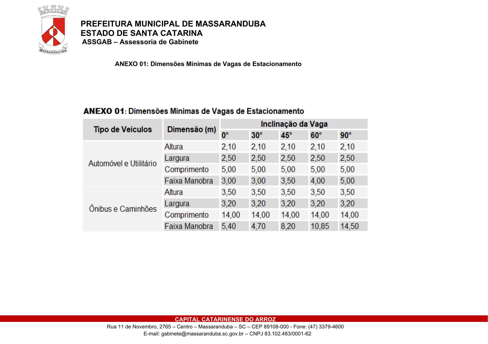
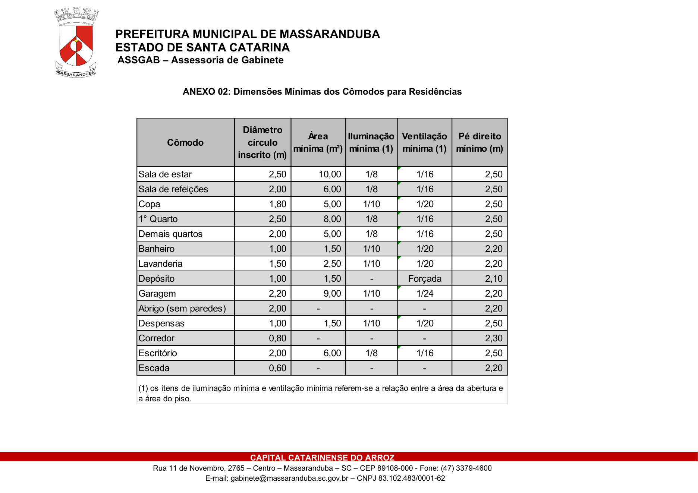
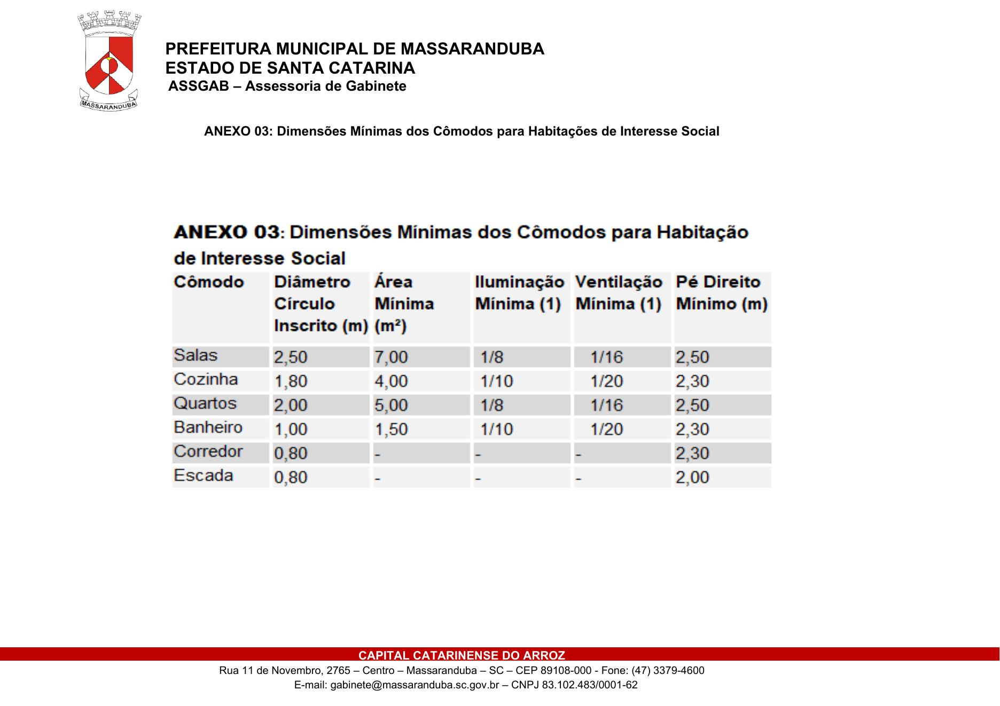
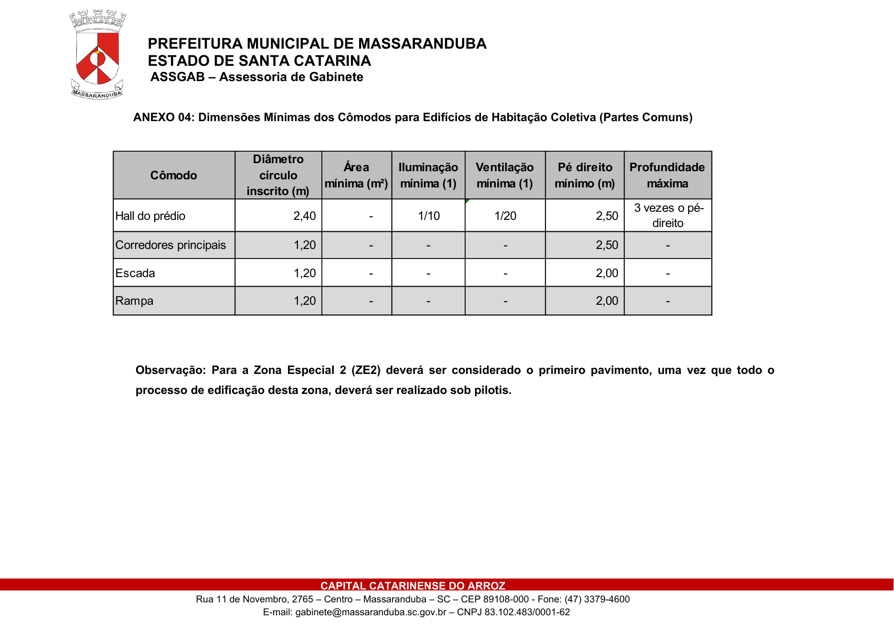
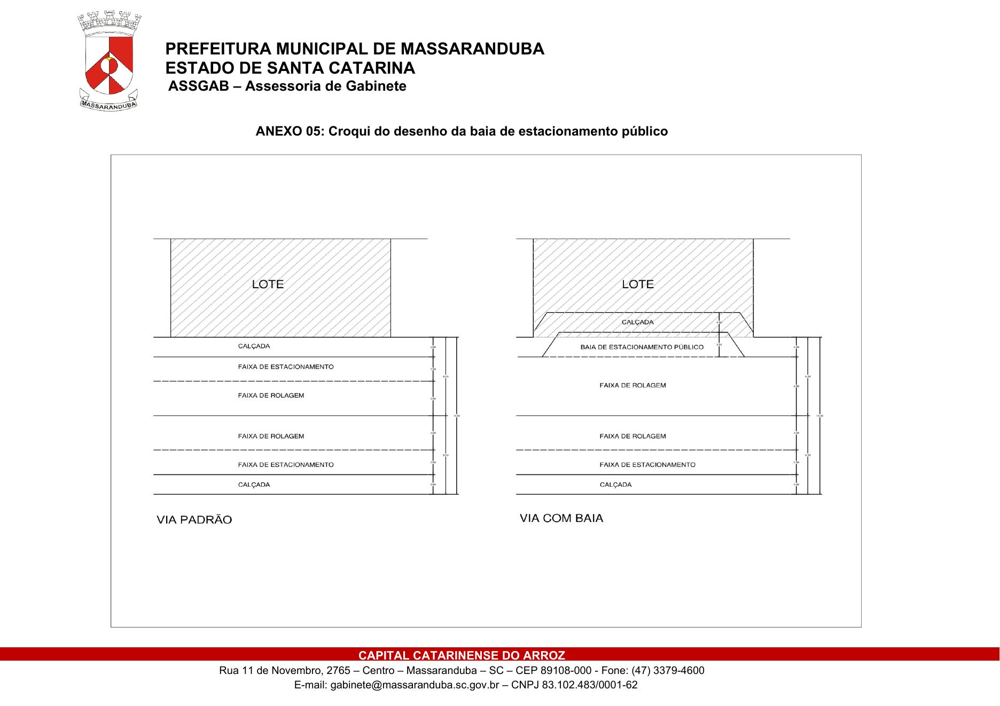
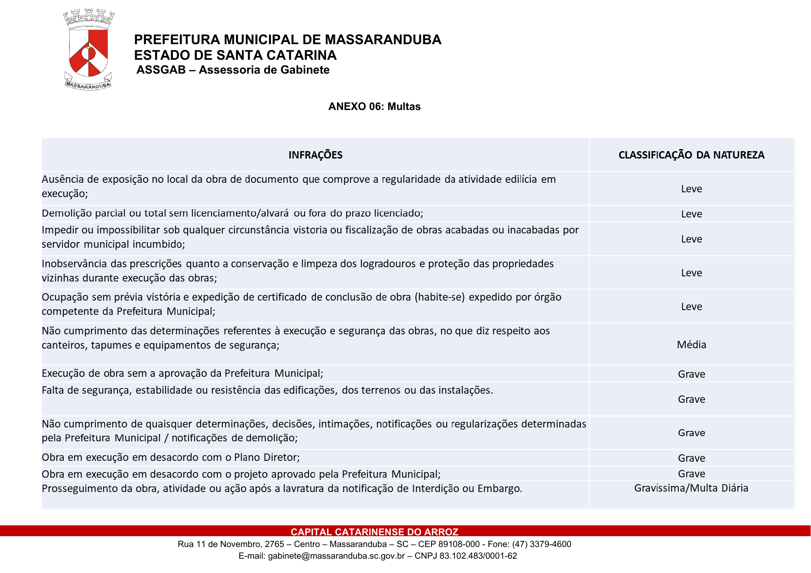

# Lei Complementar nº 181/2022

**Município de Massaranduba/SC — Código de Obras**

**Fonte oficial:** [PDF no Portal do Cidadão da Prefeitura de Massaranduba](https://massaranduba.atende.net/cidadao/pagina/atende.php?rot=1&aca=571&ajax=t&processo=viewFile&ajaxPrevent=1794770144793&file=D877BEBE613A92A6069375B1EAB2E83E92D8A6C3&sistema=WPO&classe=UploadMidia)  
**Data no fecho da lei:** 13 de dezembro de 2022.  
**Nota documental:** transcrição do texto da lei-base; não é consolidação. Nas consultas feitas até 15/11/2026, não foi localizada alteração posterior específica da LC nº 181/2022. A data de publicação do ato no diário oficial ainda não foi confirmada.

> As quebras de linha abaixo acompanham a estrutura do documento oficial. Os seis anexos foram preservados como imagens das páginas originais para manter tabelas e croqui sem reconstrução interpretativa.

LEI COMPLEMENTAR N° 181/2022  
Dispõe sobre o Código de Obras do  
Município de Massaranduba  
O PREFEITO MUNICIPAL DE MASSARANDUBA, no uso das atribuições que lhe são  
conferidas pela legislação em vigor, faz saber a todos os habitantes deste Município que a Câmara  
Municipal de Vereadores aprovou e ele sanciona e promulga a seguinte Lei Complementar:  
#### Art. 1º

Esta Lei dispõe sobre o Código de Obras do Município de Massaranduba.
  
#### Art. 2º

Serão reguladas pelo presente Código as seguintes obras efetuadas por
  
particulares ou entidade pública, na zona urbana ou rural do Município, obedecidas as prescrições  
legais federais e estaduais pertinentes:  
I - Construção, reforma, ampliação, demolição;  
II - Projetos de edificações;  
III - Serviços e obras de infraestrutura;  
IV - Abastecimento de água e esgotamento sanitário;  
V - Energia e telefonia.  
§ 1º Os projetos, serviços e obras referidas neste artigo, executados por Órgão público  
ou por iniciativa particular, estarão obrigados à prévia Licença Municipal.  
§ 2º Os projetos, serviços e obras referidas neste artigo devem ser executados de  
acordo com as exigências contidas neste Código e na Lei de Zoneamento, Uso e Ocupação do  
Solo, mediante a assunção de responsabilidade por profissional legalmente habilitado com seus  
respectivos Conselhos.  
## TÍTULO I — DAS CONSIDERAÇÕES PRELIMINARES

#### Art. 3º

Constituem objetivos do Código de Obras:
  
I - Regular a atividade edilícia, visando garantir as condições mínimas de segurança,  
conforto, higiene e salubridade das edificações e obras em geral, inclusive as destinadas ao  
funcionamento de órgãos ou serviços públicos;  
II - Atribuir direitos e responsabilidades do Município, do proprietário ou possuidor de  
imóvel, e do profissional, atuantes na atividade edilícia;  
III - Estabelecer procedimentos administrativos, regras gerais e específicas destinadas  
ao controle da atividade edilícia.  
#### Art. 4º

Todos os logradouros públicos e edificações, exceto aqueles destinados à
  
habitação de caráter permanente unifamiliar, deverão ser projetados de modo a permitir o acesso,  
circulação e utilização por pessoas portadoras de deficiência, conforme orientações previstas na  
NBR 9050 da Associação Brasileira de Normas Técnicas – ABNT.  
#### Art. 5º

Para atividades, construção ou reforma de instalações capazes de causar, sob
  
qualquer forma, impactos ao meio ambiente, será exigida, a critério do órgão competente do  
Município, aprovação prévia dos órgãos estadual e municipal de controle ambiental quando da  
aprovação do projeto, quando couber.  
Parágrafo único. Consideram-se impactos ao meio ambiente, natural e construído, as  
interferências nas condições da qualidade das águas superficiais e subterrâneas, do solo, do ar,  
da insolação e acústica das edificações e suas áreas vizinhas, bem como do uso do espaço  
urbano.  
#### Art. 6º

O projeto do qual possa decorrer risco à saúde pública, deverão atender as
  
exigências da Vigilância Sanitária, legislação estadual e federal, e ser analisado pela autoridade  
sanitária municipal, a fim de que obtenha as devidas autorizações e licenciamentos.  
#### Art. 7º

As obras a serem realizadas em construções integrantes do patrimônio
  
histórico municipal, estadual ou federal, ou nas suas vizinhanças, deverão atender às normas  
próprias estabelecidas pelo órgão de proteção competente.  
### CAPÍTULO I — DOS CONCEITOS

#### Art. 8º

Para efeito de aplicação deste Código, ficam assim conceituados os termos:
  
I - Altura da edificação: desnível real entre o pavimento do andar de saída da edificação  
e o pavimento do andar mais elevado, excluído o ático;  
II - Andar: volume compreendido entre dois pavimentos consecutivos, ou entre o  
pavimento e o nível superior de sua cobertura;  
III - Área edificada: área total coberta de uma edificação;  
IV - Ático: parte do volume superior de uma edificação, destinada a abrigar casa de  
máquinas, piso técnico de elevadores, caixas d’água e circulação vertical;  
V - Coroamento: elemento de vedação que envolve o ático;  
VI - Demolição: total derrubamento de uma edificação. (a demolição parcial ou o total  
derrubamento de um bloco de um conjunto de edificações caracteriza-se como reforma);  
VII - Edificação: obra coberta destinada a abrigar atividade humana ou qualquer  
instalação, equipamento e material;  
VIII - Edificação permanente: aquela de caráter duradouro;  
IX - Edificação transitória: aquela de caráter não permanente, passível de montagem,  
desmontagem e transporte;  
X - Equipamento: elemento destinado a guarnecer ou completar uma edificação, a esta  
integrando-se;  
XI - Equipamento permanente: aquele de caráter duradouro;  
XII - Equipamento transitório: aquele de caráter não permanente, passível de  
montagem, desmontagem e transporte;  
XIII - Edificação irregular: todas aquelas que não estão de acordo com as leis de Uso  
e Ocupação do Solo, parcelamento, Código de Obras, além das normas técnicas vigentes;  
XIV - Jirau: mobiliário constituído por estrado ou passadiço instalado a meia altura em  
compartimento;  
XV - Mezanino: pavimento que subdivide parcialmente um andar em dois andares;  
XVI - Mobiliário: elemento construtivo não enquadrável como edificação ou  
equipamento;  
XVII - Movimento de terra: modificação do perfil do terreno que implicar em alteração  
topográfica superior a 1,0 m (um metro) de desnível ou a 1.000,0 m3 (um mil metros cúbico) de  
volume, ou em terrenos pantanosos ou alagadiços;  
XVIII - Muro: elemento construtivo situado no alinhamento predial do terreno,  
construído com material que vede a visão, em relação ao nível do passeio;  
XIX - Muro de arrimo: muro destinado a suportar desnível de terreno superior a 1,0 m  
(um metro), com altura necessária para sustentar o desnível de terra entre o alinhamento do  
logradouro e do terreno a ser edificado;  
XX - Obra: realização de trabalho em imóvel, desde seu início até sua conclusão, cujo  
resultado implique na alteração de seu estado físico anterior;  
XXI - Obra complementar: edificação secundária, ou parte da edificação que,  
funcionalmente, complemente a atividade desenvolvida no imóvel;  
XXII - Obra emergencial: obra de caráter urgente, essencial à garantia das condições  
de estabilidade, segurança ou salubridade de um imóvel;  
XXIII - Pavimento: plano de piso;  
XXIV - Memorial descritivo: texto descritivo de elementos ou serviços para a  
compreensão de uma obra, tal como especificação de componentes a serem utilizados e índices  
de desempenho a serem obtidos;  
XXV - Peça gráfica: representação gráfica de elementos para a compreensão de um  
projeto ou obra;  
XXVI - Perfil do terreno: situação topográfica existente, objeto do levantamento físico  
que serviu de base para a elaboração do projeto e/ou constatação da realidade;  
XXVII - Perfil original do terreno: aquele constante dos levantamentos  
aerofotogramétricos disponíveis ou do arruamento aprovado, anteriores à elaboração do projeto;  
XXVIII - Piso drenante: aquele que permite a infiltração de águas pluviais no solo  
através de, no mínimo, 20% (vinte por cento) de sua superfície por metro quadrado;  
XXIX - Reforma: obra que implicar em uma ou mais das seguintes modificações, com  
ou sem alteração de uso: área edificada, estrutura, compartimentação vertical e/ou volumetria;  
XXX - Pequena reforma: reforma com ou sem mudança de uso na qual não haja  
supressão ou acréscimo de área, ou alterações que infrinjam as legislações edilícia e de  
parcelamento, uso e ocupação do solo;  
XXXI - Reconstrução: obra destinada à recuperação e recomposição de uma  
edificação, motivada pela ocorrência de incêndio ou outro sinistro fortuito, mantendo-se as  
características anteriores;  
XXXII - Reparo: obra ou serviço destinados à manutenção de um edifício, sem implicar  
em mudança de uso, acréscimo ou supressão de área, alteração da estrutura, da  
compartimentação horizontal ou vertical, da volumetria, e dos espaços destinados à circulação,  
iluminação e ventilação;  
XXXIII - Restauro ou restauração: recuperação de edificação tombada ou preservada,  
de modo a restituir-lhe as características originais; e  
XXXIV - Saliência: elemento arquitetônico proeminente, engastado ou aposto em  
edificação ou muro.  
## TÍTULO II — DOS DIREITOS E RESPONSABILIDADES

### CAPÍTULO I — DO MUNICÍPIO

#### Art. 9º

O Município, visando exclusivamente à observância das prescrições deste
  
Código, do Plano Diretor Municipal e da legislação correlata pertinente, licenciará e fiscalizará a  
execução, utilização e manutenção das condições de estabilidade, segurança e salubridade das  
obras, edificações e equipamentos, não se responsabilizando por qualquer sinistro ou acidente  
decorrente de deficiências do projeto, e da sua execução ou da sua utilização.  
#### Art. 10

O Município deverá assegurar, por meio do respectivo órgão competente, o
  
acesso aos munícipes a todas as informações contidas na legislação relativa ao Plano Diretor  
Municipal, Perímetros Urbanos, Parcelamento do Solo Urbano e Regularização Fundiária, Lei de  
Zoneamento, Uso e Ocupação do Solo, pertinentes ao imóvel a ser construído ou atividade em  
questão.  
#### Art. 11

O Município manterá um cadastro dos profissionais e empresas legalmente
  
habilitados.  
#### Art. 12

Fica, a critério da Municipalidade, comunicar ao Conselho Regional de
  
Engenharia e Agronomia (CREA) e/ou ao Conselho de Arquitetura e Urbanismo (CAU), quando  
constatar irregularidades e ou infrações cometidas pelos profissionais responsáveis pela obra.  
#### Art. 13

A Municipalidade aplicará as multas, estabelecidas nesta lei, aos infratores do
  
disposto neste Código.  
### CAPÍTULO II — DO PROPRIETÁRIO OU POSSUIDOR

#### Art. 14

É direito do proprietário ou possuidor promover e executar obras ou implantar
  
equipamentos no imóvel de sua propriedade, mediante prévio conhecimento e consentimento do  
Município, respeitada a legislação urbanística municipal e o direito de vizinhança.  
§ 1º Considera-se proprietário do imóvel a pessoa física ou jurídica, portadora do título  
de propriedade registrado em Cartório de Registro Imobiliário.  
§ 2º Considera-se possuidor, a pessoa, física ou jurídica, que tenha de fato o direito  
de usar e alterar as características do imóvel objeto da obra.  
§ 3º A análise dos pedidos de emissão dos documentos previstos neste código  
dependerá, quando for o caso, da apresentação do Título de Propriedade registrado no Registro  
de Imóveis, sendo o proprietário ou possuidor do imóvel, ou seus sucessores a qualquer título,  
responsáveis, civil e criminalmente, pela veracidade dos documentos e informações apresentadas  
ao Município, não implicando sua aceitação em reconhecimento do direito de propriedade sobre  
o imóvel.  
#### Art. 15

O proprietário ou possuidor do imóvel, ou seus sucessores a qualquer título,
  
são responsáveis pela manutenção das condições de estabilidade, segurança e salubridade dos  
imóveis, edificações e equipamentos, bem como pela observância das prescrições deste Código  
e legislação municipal correlata, assegurando-lhes todas as informações cadastradas na  
Municipalidade, relativas ao seu imóvel.  
### CAPÍTULO III — DO PROFISSIONAL RESPONSÁVEL TÉCNICO

#### Art. 16

É obrigatória a assistência de profissional habilitado na elaboração de projetos,
  
na execução e na implantação de obras, sempre que assim o exigir a legislação federal relativa  
ao exercício profissional.  
#### Art. 17

Profissional habilitado é o técnico registrado junto ao órgão federal fiscalizador
  
do exercício profissional, podendo atuar como pessoa física ou como responsável por pessoa  
jurídica, respeitada as atribuições e limitações consignadas por aquele organismo e devidamente  
licenciado pelo Município.  
#### Art. 18

Será considerado autor, o profissional habilitado responsável pela elaboração
  
de projetos, que responderá pelo conteúdo das peças gráficas, descritivas, especificações e  
exequibilidade de seu trabalho.  
#### Art. 19

A responsabilidade pela elaboração de projetos, cálculos, especificações e
  
pela execução de obras é do profissional que a assinar, não assumindo o Município, em  
consequência da aprovação, qualquer responsabilidade sobre tais atos.  
#### Art. 20

Será considerado Responsável Técnico da Obra, o profissional responsável
  
pela direção técnica das obras, desde seu início até sua total conclusão, respondendo por sua  
correta execução e adequado emprego de materiais, conforme projeto aprovado na  
Municipalidade e observância da legislação em vigor.  
#### Art. 21

É obrigação do responsável técnico, ou do proprietário, manter no local da
  
obra, à disposição da fiscalização municipal, uma cópia do projeto aprovado, do respectivo alvará,  
bem como a colocação da placa da obra em posição bem visível, enquanto perdurarem as obras.  
Parágrafo único. A placa da Obra deve conter as seguintes informações:  
I - Endereço completo da obra;  
II - Nome do proprietário;  
III - Nome(s) do(s) responsável (eis) técnico(s) pelo(s) projeto(s) e pela construção,  
categoria profissional e número da respectiva carteira;  
IV - Finalidade da obra; e  
V - Número do Alvará ou QR-Code do Alvará de Construção.  
#### Art. 22

É permitida a substituição de profissionais responsáveis pela execução de
  
obras, nos termos da legislação profissional regulada pelo Conselho Regional de Engenharia e  
Agronomia (CREA) e/ou Conselho de Arquitetura e Urbanismo (CAU), devendo o Município ser  
comunicado, pelo novo responsável, em prazo de 5 dias úteis após o deferimento da substituição  
pelo Conselho.  
#### Art. 23

A atuação do profissional que incorra em comprovada imperícia, má fé ou
  
direção de obra sem os documentos exigidos pelo Município, será comunicada ao órgão  
fiscalizador do exercício profissional.  
## TÍTULO III — DAS OBRAS PÚBLICAS

#### Art. 24

As obras públicas não poderão ser executadas sem autorização da Prefeitura,
  
devendo obedecer às determinações do presente Código ficando, entretanto, isentas de  
pagamento de emolumentos, as seguintes obras:  
I - Construção de edifícios públicos;  
II - Obras de qualquer natureza em propriedade da União ou Estado;  
III - Obras a serem realizadas por instituições oficiais ou paraestatais quando para a  
sua sede própria;  
IV - Obras para entidades com fins filantrópicos.  
#### Art. 25

O processamento do pedido de licença para obras públicas será feito com
  
preferência sobre quaisquer outros processos.  
#### Art. 26

O pedido de licença será feito por meio de ofício dirigido ao Prefeito pelo órgão
  
interessado, devendo este ofício ser acompanhado do projeto completo da obra a ser executada,  
conforme exigências deste Código.  
#### Art. 27

Os projetos deverão ser assinados por profissional legalmente habilitado.
  
#### Art. 28

Os contratantes ou executantes das obras públicas estão sujeitos ao
  
pagamento das licenças relativas ao exercício da respectiva profissão, a não ser que se trate de  
funcionário que deva executar as obras em função do cargo.  
#### Art. 29

As obras pertencentes à Municipalidade ficam sujeitas na sua execução, à
  
obediência das determinações do presente Código.  
## TÍTULO IV — DAS OBRAS EXISTENTES, REFORMAS, REGULARIZAÇÕES E

RECONSTRUÇÕES DE EDIFICAÇÕES  
### CAPÍTULO I — DAS REFORMAS

#### Art. 30

As edificações existentes regulares poderão ser reformadas desde que a
  
reforma não crie nem agrave eventual desconformidade com esta Lei ou com a Lei de  
Zoneamento, Uso e Ocupação do Solo.  
### CAPÍTULO II — DAS REGULARIZAÇÕES

#### Art. 31

As edificações irregulares, no todo ou em parte, poderão ser regularizadas,
  
desde que atendam ao disposto na Lei Municipal n° 1681/2015, que dispõe sobre a Certidão de  
Regularização de Edificação (CRE).  
## TÍTULO V — DAS OBRAS PARALISADAS OU EM RUÍNAS

#### Art. 32

No caso de paralisação da obra por mais de 3 (três) anos, a Prefeitura
  
mandará proceder a uma vistoria e tratando-se de ruína eminente, intimará o proprietário a mandar  
demoli-la, sob pena de ser feita a demolição pela Prefeitura, cobrando as despesas cabíveis.  
#### Art. 33

Nas obras paralisadas por mais de 90 (noventa) dias, deverá ser feito o
  
fechamento do terreno, no alinhamento do logradouro por meio de muro dotado de portão de  
entrada, observadas as exigências desta Lei, para fechamento dos terrenos.  
#### Art. 34

Durante o período de paralisação, o proprietário será responsável pela
  
vigilância ostensiva da obra, de forma a impedir a ocupação do imóvel.  
Parágrafo único. A obrigação estende-se às pessoas jurídicas de direito público ou  
privado.  
#### Art. 35

Todas as obras de demolição ou execução de serviços necessários deverão
  
ser acompanhadas por responsável técnico habilitado, o qual deverá tomar as medidas relativas  
à segurança, durante a sua execução.  
#### Art. 36

No caso de obra comprometida estruturalmente, o órgão competente poderá
  
determinar medidas necessárias para garantir a estabilidade de edificação.  
#### Art. 37

Para imóveis tombados, será ouvido o órgão competente, em atendimento às
  
normas legais pertinentes, sem prejuízo da vedação e lacramento necessários.  
## TÍTULO VI — DA DEMOLIÇÃO VOLUNTÁRIA

#### Art. 38

Nenhuma demolição de edificação ou obra permanente, de qualquer natureza,
  
poderá ser realizada sem prévio requerimento à Prefeitura, que expedirá o Alvará de Demolição.  
#### Art. 39

Do requerimento, deverão constar os métodos a serem usados na demolição.
  
#### Art. 40

Imóveis tombados não poderão ser demolidos, descaracterizados, mutilados
  
ou destruídos.  
#### Art. 41

Se a demolição for de construção localizada, no todo ou em parte, junto ao
  
alinhamento dos logradouros, será expedida, concomitantemente, a licença relativa a andaimes  
ou tapumes.  
#### Art. 42

Em qualquer demolição, o profissional responsável ou o proprietário, conforme
  
o caso, porá em prática todas as medidas necessárias e possíveis para garantir a segurança dos  
operários e do público, dos logradouros e das propriedades vizinhas, obedecendo ao disposto  
neste Código.  
#### Art. 43

No caso de nova construção, a licença para demolição poderá ser expedida
  
conjuntamente com a licença para construção.  
#### Art. 44

Os órgãos municipais competentes poderão, sempre que julgarem
  
conveniente, estabelecer horários para demolição.  
#### Art. 45

No término da demolição, o proprietário deverá requerer a Certidão de
  
Demolição.  
## TÍTULO VII — DAS OBRAS EM LOGRADOUROS PÚBLICOS

#### Art. 46

A execução de obra ou serviço público ou particular em logradouro público
  
depende de prévio licenciamento da Prefeitura Municipal.  
#### Art. 47

Concluída a obra ou serviço, o proprietário comunicará a Prefeitura o seu
  
término, a qual realizará vistoria para verificar o cumprimento das condições previstas no  
respectivo licenciamento.  
#### Art. 48

Concluída a obra ou serviço, o proprietário será responsável pela
  
solução/reparação de qualquer defeito nos termos da legislação federal.  
### CAPÍTULO I — DOS PASSEIOS

#### Art. 49

É obrigação legal do proprietário ou possuidor a qualquer título, de imóvel
  
edificado ou não, com frente para a via e/ou logradouro público dotado de pavimentação,  
localizado na zona urbana e rural do município, executar as respectivas calçadas, obedecendo às  
determinações da Lei Municipal n° 1544/2013, na extensão da sua testada, e mantê-las sempre  
em perfeito estado de conservação.  
### CAPÍTULO II — DO REBAIXAMENTO DE GUIAS E MEIO FIO

#### Art. 50

As guias rebaixadas em ruas pavimentadas só poderão ser feitas mediante
  
licença, quando requerido pelo proprietário ou representante legal, desde que exista local para  
estacionamento de veículos.  
#### Art. 51

Quando da expedição do Alvará de Construção, será exigida a indicação das
  
guias rebaixadas em projeto.  
#### Art. 52

O rebaixamento do meio-fio é permitido apenas para acesso dos veículos,
  
observando-se que:  
I - A rampa destinada a vencer a altura do meio-fio não pode ultrapassar 1/3 (um terço)  
da largura do passeio, até o máximo de 0,5 m (cinquenta centímetros);  
II - Poderá haver aberturas com, no máximo, 8,00m (oito metros) cada uma e que  
ficarão sempre distanciadas por intervalos medindo 5,00m (cinco metros), no mínimo, sendo  
obrigatório reservar 5,00m (cinco metros) para uma vaga na via pública, quando permitido;  
III - O início da rampa deverá situar-se a uma distância mínima de 5,0m (cinco metros  
e cinquenta centímetros) da esquina, entendida como o ponto de intersecção dos alinhamentos  
do lote.  
#### Art. 53

Em edificações destinadas a postos de gasolina, garagens coletivas,
  
comércios atacadistas e indústrias, os rebaixamentos de nível e rampas de acessos deverão  
atender:  
I - A largura máxima de 6,0 m (seis metros) por acessos;  
II - A soma total das larguras não poderá ser superior a 12,0 m (doze metros), medidas  
no alinhamento do meio-fio.  
#### Art. 54

O rebaixamento de guias nos passeios só será permitido quando não resultar
  
em prejuízo para a arborização pública, ficando a juízo do órgão competente a autorização do  
corte de árvores, desde que atendidas as exigências do mesmo.  
#### Art. 55

O rebaixamento de guias é obrigatório, sempre que for necessário o acesso
  
de veículos aos terrenos ou prédios, através do passeio ou logradouro, sendo proibida a colocação  
de cunhas, rampas de madeira ou outro material, fixas ou móveis, na sarjeta ou sobre o passeio.  
#### Art. 56

As notificações para a regularização de guia deverão ser executadas no prazo
  
máximo de 30 (trinta) dias.  
## TÍTULO VIII — DA EXECUÇÃO E SEGURANÇA DAS OBRAS

#### Art. 57

A execução de obras, incluindo os serviços preparatórios e complementares,
  
suas instalações e equipamentos, será procedida de forma a obedecer ao projeto aprovado, à boa  
técnica, às normas técnicas e ao direito de vizinhança, a fim de garantir a segurança dos  
trabalhadores, da comunidade, das propriedades e dos logradouros públicos, observados em  
especial a legislação trabalhista pertinente.  
### CAPÍTULO I — DO CANTEIRO DE OBRAS E INSTALAÇÕES TEMPORÁRIAS

#### Art. 58

As instalações temporárias que compõem o canteiro de obras somente serão
  
permitidas após a expedição de Alvará de Construção da obra, obedecido ao seu prazo de  
validade.  
#### Art. 59

O canteiro de obras compreenderá a área destinada à execução e
  
desenvolvimento das obras, serviços complementares, implantação de instalações temporárias  
necessárias à sua execução, sendo permitido: tapumes, barracões, escritório de campo, depósito  
de materiais e detritos, estande de vendas, sanitários, poços, água, energia, caçamba, vias de  
acesso e circulação, transporte e vestiários.  
#### Art. 60

Durante a execução das obras, será obrigatória a manutenção do passeio
  
desobstruído e em perfeitas condições, proibida a permanência de qualquer material de  
construção nas vias e logradouros públicos, bem como a utilização dos mesmos como canteiro de  
obras ou depósito de entulhos, salvo no lado interior dos tapumes que avançarem sobre o  
logradouro.  
#### Art. 61

A não retirada dos materiais de construção ou do entulho autoriza a Prefeitura
  
Municipal a fazer a remoção do material encontrado em via pública, dando-se o destino  
conveniente, e a cobrar dos proprietários da obra a despesa de remoção, bem como a aplicação  
das sanções cabíveis.  
### CAPÍTULO II — DO FECHAMENTO DO CANTEIRO DE OBRAS

#### Art. 62

Enquanto durarem as obras, o responsável técnico deverá adotar as medidas
  
e equipamentos necessários à proteção e segurança dos que nela trabalham, dos pedestres, das  
propriedades vizinhas e dos logradouros e vias públicas.  
#### Art. 63

Para todas as construções, reformas, reparos ou demolições, será obrigatório
  
o fechamento no alinhamento, do canteiro de obras, por alvenaria, tela tapume, tapume de madeira  
ou metálico, com altura mínima de 2,00m (dois metros), salvo quando se tratar da execução de  
muros, grades, gradis ou de pintura e pequenos reparos na edificação que não comprometam a  
segurança dos pedestres.  
#### Art. 64

Os tapumes somente poderão ser colocados após expedição, pelo órgão
  
competente do Município, da licença de construção ou demolição.  
#### Art. 65

Tapumes e andaimes não poderão ocupar mais do que a metade da largura
  
do passeio, sendo que, no mínimo, 1,20 m (um metro e vinte centímetros) deverão ser mantidos  
livres para o fluxo de pedestres.  
#### Art. 66

O Município, por meio do órgão competente, poderá autorizar, por prazo
  
determinado, ocupação superior à fixada de 0,8 m (oitenta centímetros), desde que seja  
tecnicamente comprovada sua necessidade e adotadas medidas de proteção para circulação de  
pedestres.  
#### Art. 67

Nenhum elemento do canteiro de obras poderá prejudicar a arborização da
  
rua, a iluminação pública, a visibilidade de placas, avisos ou sinais de trânsito, e outras instalações  
de interesse público.  
#### Art. 68

Concluídos os serviços de fachada, ou paralisada a obra por período superior
  
a 30 (trinta) dias, o tapume será obrigatoriamente recuado para o alinhamento.  
### CAPÍTULO III — DAS PLATAFORMAS DE SEGURANÇA E VEDAÇÃO EXTERNA DAS OBRAS

#### Art. 69

Nas obras ou serviços que se desenvolverem a mais de 9,0 m (nove metros)
  
de altura, será obrigatória a execução de:  
I - Plataformas de segurança a cada 8,0 m (oito metros) ou 3 (três) pavimentos;  
II - Vedação externa que a envolva totalmente.  
### CAPÍTULO IV — DAS ESCAVAÇÕES, MOVIMENTOS DE TERRA, ARRIMO E DRENAGEM

#### Art. 70

As escavações, movimentos de terra, arrimo e drenagem e outros processos
  
de preparação e de contenção do solo, somente poderão ter início após a expedição do devido  
licenciamento pelos órgãos municipais competentes.  
#### Art. 71

No caso da existência de vegetação de preservação, definida na legislação
  
específica, deverão ser providenciadas as devidas autorizações para a realização das obras junto  
aos órgãos competentes.  
#### Art. 72

Antes do início das escavações ou movimentos de terra, deverá ser verificada
  
a existência ou não de tubulações e demais instalações sob o passeio do logradouro público que  
possam vir a ser comprometidos pelos trabalhos executados.  
#### Art. 73

Toda e qualquer obra executada deverá possuir, em sua área interna, um
  
sistema de contenção contra o carreamento de terras e resíduos, com o objetivo de evitar que  
estes sejam carreados para galerias de águas pluviais, córregos, rios e lagos, causando  
assoreamento e prejuízos ambientais aos mesmos.  
#### Art. 74

O terreno circundante a qualquer construção deverá proporcionar escoamento
  
às águas pluviais e protegê-la contra infiltrações ou erosões.  
#### Art. 75

As condições naturais de absorção das águas pluviais no lote deverão ser
  
garantidas pela execução de um ou mais dos seguintes dispositivos:  
I – Atender a porcentagem mínima de permeabilidade estabelecida na Lei de  
Zoneamento, Uso e Ocupação do Solo;  
II – Construção de reservatório ligado a sistema de drenagem, no caso de edificações  
construídas na Zona Central.  
#### Art. 76

Os passeios e logradouros públicos e eventuais instalações de serviço público
  
especiais deverão ser adequadamente escorados e protegidos.  
#### Art. 77

O órgão competente poderá exigir dos proprietários a construção, manutenção
  
e contenção do terreno, sempre que for alterado o perfil natural do mesmo pelo proprietário ou seu  
preposto. Esta medida também será determinada em relação aos muros de arrimo no interior dos  
terrenos e em suas divisas, quando colocarem em risco as construções existentes no próprio  
terreno ou nos vizinhos, cabendo a responsabilidade das obras de contenção à aquele que alterou  
a topografia natural.  
### CAPÍTULO V — DAS SONDAGENS

#### Art. 78

A execução de sondagens em terrenos particulares será realizada de acordo
  
com as normas técnicas vigentes da Associação Brasileira de Normas Técnicas - ABNT.  
## TÍTULO IX — DOS COMPONENTES MATERIAIS, ELEMENTOS CONSTRUTIVOS E

EQUIPAMENTOS  
#### Art. 79

Além do atendimento às disposições deste Código, os componentes das
  
edificações deverão atender às especificações constantes da Associação Brasileira de Normas  
Técnicas - ABNT, mesmo quando sua instalação não seja obrigatória por este Código.  
#### Art. 80

O dimensionamento, especificação e emprego dos materiais e elementos
  
construtivos deverão assegurar a estabilidade, segurança e salubridade das obras, edificações e  
equipamentos, garantindo desempenho, no mínimo, similar aos padrões estabelecidos neste  
Código.  
#### Art. 81

O desempenho obtido pelo emprego de componentes, em especial daqueles
  
ainda não consagrados pelo uso, bem como quando em utilizações diversas das habituais, será  
de inteira responsabilidade do profissional que os tenha especificado ou adotado.  
#### Art. 82

A Municipalidade poderá desaconselhar o emprego de componentes
  
considerados inadequados, que possam vir a comprometer o desempenho desejável, bem como  
referendar a utilização daqueles cuja qualidade seja notável.  
#### Art. 83

As edificações deverão observar os princípios básicos de conforto, higiene e
  
salubridade de forma a não transmitir, aos imóveis vizinhos e aos logradouros públicos ruídos,  
vibrações e temperaturas em níveis superiores aos previstos nos regulamentos oficiais próprios.  
#### Art. 84

Visando o controle da proliferação de zoonoses, os componentes das
  
edificações, bem como instalações e equipamentos, deverão dispor de condições que impeçam o  
acesso e alojamento de animais transmissores de moléstias.  
### CAPÍTULO I — DOS COMPONENTES BÁSICOS

#### Art. 85

Os componentes básicos da edificação, que compreendem fundações,
  
estruturas, paredes e cobertura, deverão apresentar resistência ao fogo, isolamento térmico,  
isolamento e condicionamento acústico, estabilidade e impermeabilidade adequados à função e  
porte do edifício, de acordo com as normas técnicas, especificados e dimensionados por  
profissional habilitado, devendo garantir:  
a) Segurança ao fogo;  
b) Conforto térmico e acústico;  
c) Segurança estrutural;  
d) Estanqueidade.  
#### Art. 86

Nenhuma edificação poderá ser construída sobre terreno úmido, pantanoso,
  
instável ou contaminado por substâncias orgânicas ou tóxicas sem o saneamento prévio do solo.  
#### Art. 87

Os trabalhos de saneamento do terreno deverão estar comprovados por meio
  
de laudos técnicos, pareceres ou atestados que certifiquem a realização das medidas corretivas,  
assegurando as condições sanitárias, ambientais e de segurança para a sua ocupação.  
#### Art. 88

As fundações e estruturas deverão ficar situadas inteiramente dentro dos
  
limites do lote, não podendo em hipótese alguma, avançar sob o passeio do logradouro, sob  
imóveis vizinhos ou sob o recuo obrigatório, se houver.  
#### Art. 89

No que tange ao cálculo das fundações e estrutura, serão obrigatoriamente
  
considerados:  
I - Os efeitos para com as edificações vizinhas;  
II - Os bens de valor cultural;  
III - Os logradouros públicos; e  
IV - As instalações de serviços públicos.  
#### Art. 90

As paredes que estiverem em contato direto com o solo deverão ser
  
impermeabilizadas.  
#### Art. 91

As paredes dos andares acima do solo, que não forem vedados por paredes
  
perimetrais, deverão dispor de guarda-corpo de proteção contra queda, com altura mínima de 1,10  
m (um metro e dez centímetros) resistente a impactos e pressão.  
#### Art. 92

Se o guarda-corpo for vazado, deverá assegurar condições de segurança
  
contra transposição de esfera com diâmetro superior a 0,15 m (quinze centímetros).  
#### Art. 93

Quando a edificação estiver junto à divisa, deverá obrigatoriamente possuir
  
platibanda.  
#### Art. 94

Todas as edificações com beiral com caimento no sentido da divisa, deverão
  
possuir calha quando o afastamento deste a divisa for inferior a 0,75 m (setenta e cinco  
centímetros).  
#### Art. 95

A cobertura de edificações agrupadas horizontalmente deverá ter estrutura
  
independente para cada unidade autônoma e a parede divisória deverá propiciar total separação  
entre os forros e demais elementos estruturais das unidades.  
### CAPÍTULO II — DAS INSTALAÇÕES PREDIAIS

#### Art. 96

A execução de instalações prediais, tais como, as de água potável, águas
  
pluviais, esgoto, luz, força, para-raios, telefone, gás e disposição de resíduos sólidos, deverão ser  
projetados, calculados e executados, visando à segurança, higiene e conforto dos usuários, de  
acordo com as disposições deste Código e da Associação Brasileira de Normas Técnicas - ABNT  
vigentes.  
#### Art. 97

Todas as instalações e equipamentos exigem responsável técnico legalmente
  
habilitado, no que se refere ao projeto, instalação, manutenção e conservação.  
#### Seção I — DAS INSTALAÇÕES PLUVIAIS

#### Art. 98

Os terrenos, ao receberem edificações, deverão ser convenientemente
  
preparados para escoamento das águas pluviais e de infiltração com adoção de medidas de  
controle da erosão.  
#### Art. 99

Não será permitido o despejo de águas pluviais ou servidas, inclusive daquelas
  
provenientes do funcionamento de equipamentos, sobre as calçadas e os imóveis vizinhos,  
devendo as mesmas ser conduzidas por canalização sob o passeio à rede coletora própria, de  
acordo com as normas emanadas do órgão competente.  
#### Art. 100

A construção sobre valas ou redes pluviais existentes no interior dos terrenos
  
e que conduzam águas de terrenos vizinhos somente será admitida após análise caso a caso pelo  
órgão competente do Município.  
#### Art. 101

Somente o Município poderá autorizar ou promover a eliminação ou
  
canalização de redes pluviais bem como a alteração do curso das águas.  
#### Art. 102

Todas as edificações localizadas nas áreas onde houver sistema de
  
esgotamento sanitário com rede coletora e sem tratamento final, deverão ter seus esgotos  
conduzidos a sistemas individuais ou coletivos, para somente depois serem conduzidos à rede de  
esgotamento sanitário existente.  
#### Art. 103

Os efluentes de fossas sépticas deverão ser devidamente coletados e
  
tratados, tendo seu lançamento condicionado aos locais determinados pelo respectivo  
licenciamento ambiental, de acordo com determinações da Associação Brasileira de Normas  
Técnicas – ABNT.  
#### Art. 104

Todas as edificações localizadas nas áreas onde houver sistema de
  
esgotamento sanitário com rede coletora e com tratamento final deverão ter seus esgotos  
conduzidos diretamente à rede existente de esgotamento sanitário.  
#### Art. 105

As águas provenientes das pias de cozinha e copas deverão passar por uma
  
caixa de gordura antes de serem esgotadas.  
#### Art. 106

Toda edificação deverá dispor de reservatório elevado de água potável de
  
acordo com as determinações da Associação Brasileira de Normas Técnicas – ABNT.  
#### Art. 107

Todo imóvel está sujeito à fiscalização relativa aos efluentes hídricos, ficando
  
assegurado o acesso dos fiscais.  
#### Seção II — DA PREVENÇÃO DE INCÊNDIO

#### Art. 108

Todas as edificações, segundo sua ocupação, uso e carga de incêndio,
  
deverão dispor de sistema de proteção contra incêndio, alarme e condições de evacuação, sob  
comando ou automático, conforme as disposições e normas técnicas específicas.  
#### Art. 109

Para edifícios existentes, em que se verifique a necessidade de realização
  
de adequações, estas serão exigidas pelo órgão competente, atendendo a legislação específica.  
#### Seção III — DAS INSTALAÇÕES ELÉTRICAS

#### Art. 110

As edificações deverão ter suas instalações elétricas executadas de acordo
  
com as normas da Associação Brasileira de Normas Técnicas (ABNT) e regulamentos de  
instalações da concessionária de energia elétrica.  
#### Seção IV — DAS INSTALAÇÕES PARA ANTENAS DE TELEVISÃO

#### Art. 111

Nas edificações residenciais multifamiliares é obrigatória a instalação de
  
tubulação para antenas de televisão em cada unidade autônoma.  
#### Seção V — DAS INSTALAÇÕES TELEFÔNICAS

#### Art. 112

A instalação de equipamentos de rede telefônica nas edificações obedecerá
  
à norma NBR 5410, da Associação Brasileira de Normas Técnicas, e os regulamentos da  
concessionária local.  
#### Seção VI — DO CONDICIONAMENTO AMBIENTAL

#### Art. 113

Nas edificações que requeiram o fechamento das aberturas para o exterior,
  
os compartimentos deverão ser providos de equipamento de renovação de ar ou de ar  
condicionado, conforme estabelecido nas normas técnicas vigentes, devendo:  
I - A temperatura resultante no interior dos compartimentos deverá ser compatível com  
as atividades desenvolvidas;  
II - O equipamento deverá funcionar ininterruptamente durante o período de atividades  
do local, mesmo durante intervalos, de modo a garantir permanentemente a condições de  
temperatura e qualidade do ar;  
III - Atender a legislação especifica quanto à geração de ruídos.  
#### Seção VII — DA INSONORIZAÇÃO

#### Art. 114

As edificações que ultrapassarem os níveis máximos de intensidade
  
definidos pela NBR 10151, da Associação Brasileira de Normas Técnicas, deverão receber  
tratamento acústico adequado, de modo a não perturbar o bem-estar público ou particular, com  
sons ou ruídos de qualquer natureza.  
#### Art. 115

As instalações e equipamentos causadores de ruídos, vibrações ou choques
  
deverão possuir sistemas de segurança adequados, para prevenir a saúde do trabalhador,  
usuários ou incômodo à vizinhança.  
#### Seção VIII — DA INSTALAÇÃO DE GÁS

#### Art. 116

Os ambientes ou compartimentos que contiverem equipamentos ou
  
instalações com funcionamento a gás, deverão ter ventilação permanente, assegurada por  
aberturas diretas para o exterior, atendendo as normas técnicas vigentes.  
#### Art. 117

O armazenamento de recipientes de gás deverá estar fora das edificações,
  
em ambiente exclusivo, não podendo ser enterrado (abaixo do solo), dotado de aberturas para  
ventilação permanente.  
#### Art. 118

É obrigatória a construção de chaminés de descarga dos gases de
  
combustão dos aquecedores a gás.  
#### Seção IX — DO ABRIGO PARA GUARDA DE LIXO

#### Art. 119

Todas as edificações independentemente do uso e área de construção,
  
deverão ser dotadas de abrigo destinado a guarda de lixo, com capacidade adequada e suficiente  
para acomodar os diferentes recipientes dos resíduos, localizado no interior do lote, em local  
desimpedido e de fácil acesso à coleta, não podendo abrir sobre a calçada, obedecendo às normas  
estabelecidas pelo órgão competente e as normas técnicas vigentes.  
#### Art. 120

As edificações destinadas a hospitais, farmácias, clínicas médicas ou
  
veterinárias e assemelhados deverão ser providas de instalação especial para coleta e eliminação  
de lixo séptico, de acordo com as normas emanadas do órgão competente, distinguindo-se da  
coleta pública de lixo comum.  
#### Art. 121

Conforme a natureza e o volume dos resíduos sólidos serão adotados
  
medidas especiais para a sua remoção, conforme as normas estabelecidas pelo Código de  
Vigilância Sanitária e órgão competente.  
#### Seção X — DOS EQUIPAMENTOS MECÂNICOS

#### Art. 122

Todo equipamento mecânico, independentemente de sua posição no imóvel,
  
deverá ser instalado de forma a não transmitir ao imóvel vizinho e aos logradouros públicos, ruídos,  
vibrações e temperaturas em níveis superiores aos previstos nos regulamentos oficiais próprios.  
#### Art. 123

Qualquer equipamento mecânico de transporte vertical não poderá se
  
constituir no único meio de circulação e acesso as edificações.  
#### Art. 124

Só serão permitidas as instalações mecânicas, tais como, elevadores,
  
escadas rolantes, planos inclinados, caminhos aéreos ou quaisquer outros aparelhos de  
transporte, para uso particular, comercial ou industrial, quando executada por empresa  
especializada, com profissional legalmente habilitado e devidamente licenciado pelo órgão  
competente.  
#### Art. 125

Todos os projetos e detalhes construtivos das instalações deverão ser
  
assinados pelo representante da empresa especializada em instalação e pelo profissional  
responsável técnico da mesma.  
#### Art. 126

O projeto, a instalação e a manutenção dos elevadores e das escadas
  
rolantes deverão obedecer às normas técnicas da Associação Brasileira de Normas Técnicas –  
ABNT.  
#### Art. 127

As escadas rolantes são consideradas como aparelhos de transporte vertical,
  
porém sua existência não será levada em conta para o efeito do cálculo do escoamento das  
pessoas da edificação, nem para o cálculo da largura mínima das escadas fixas.  
#### Art. 128

Os patamares de acesso, sejam de entrada ou saída, deverão ter quaisquer
  
de suas dimensões, no plano horizontal, acima de três vezes a largura da escada rolante, com o  
mínimo de 1,5 m (um metro e cinquenta centímetros).  
#### Art. 129

É obrigatória a inspeção periódica e expedição de um relatório anual dos
  
equipamentos das instalações mecânicas pela empresa de manutenção, assinado por profissional  
responsável.  
#### Art. 130

O Relatório de Inspeção deverá permanecer em poder do proprietário da
  
instalação, para pronta exibição à fiscalização municipal.  
### CAPÍTULO III — DOS COMPLEMENTOS DA EDIFICAÇÃO

#### Seção I — DOS MUROS, CERCAS E GRADES

#### Art. 131

Os muros, muretas, floreiras, cercas vivas ou assemelhados são elementos
  
que definem o alinhamento predial do imóvel e consideradas vedações.  
#### Art. 132

Entre propriedades urbanas e rurais serão comuns os muros e cercas
  
divisórias devendo os proprietários dos imóveis confinantes dividir proporcionalmente as despesas  
de sua construção e conservação, na forma do artigo 1297 da Lei Federal 10.406/2002 (Código  
Civil Brasileiro).  
#### Art. 133

Nos terrenos de esquina as vedações situadas no alinhamento do logradouro
  
público deverão ter o canto chanfrado ou em curva, sempre respeitando o raio mínimo de 5 (cinco)  
metros no alinhamento predial.  
#### Art. 134

Em terrenos com edificações de uso residencial, é facultativa a construção
  
de vedação no alinhamento dos logradouros públicos, nas divisas laterais e na faixa do recuo  
frontal, devendo o recuo ser ajardinado e possuir elementos que permitam a identificação de todos  
os seus limites.  
#### Seção II — DAS FACHADAS E ELEMENTOS CONSTRUTIVOS EM BALANÇO

#### Art. 135

A composição das fachadas deve garantir as condições térmicas, luminosas
  
e acústicas internas presentes neste Código.  
#### Art. 136

Os elementos construtivos em balanço tais como marquises, varandas,
  
brises, saliências ou platibandas, deverão adaptar-se às condições dos logradouros, quanto à  
sinalização, posteamento, tráfego de pedestres e veículos, arborização, sombreamento e redes  
de infraestrutura, exceto em condições excepcionais e mediante negociação junto ao Município.  
#### Art. 137

As saliências para contorno de aparelhos de ar condicionado poderão
  
alcançar o limite máximo de 0,70m (setenta centímetros), desde que sejam individuais para cada  
aparelho, possuam largura e altura não superiores a 1,00m (um metro) e mantenham afastamento  
mínimo de 1,50m (um metro e cinquenta centímetros) das divisas.  
#### Art. 138

Os beirais deverão ser construídos de maneira a não permitirem o
  
lançamento das águas pluviais sobre o terreno vizinho ou o logradouro público.  
#### Art. 139

Serão permitidas as projeções de jardineiras, saliências, quebra-sóis, beirais
  
e elementos decorativos sobre os afastamentos, com no máximo 1,0 (um metro) de profundidade.  
#### Seção III — DAS MARQUISES

#### Art. 140

A construção de marquises e toldos na testada dos edifícios deverá obedecer
  
às seguintes condições:  
I - Para construções no alinhamento predial, não exceder a largura dos passeios  
menos 0,5 m (cinquenta centímetros), e ficar em qualquer caso, sujeita a balanço máximo de 1,5  
m (um metro e cinquenta centímetros);  
II - Para construções situadas em locais em que a Lei de Zoneamento, Uso e  
Ocupação do Solo exija recuo do alinhamento predial, a marquise não poderá exceder 1,5 m (um  
metro e cinquenta centímetros), sobre a faixa de recuo;  
III - Não apresentar em qualquer de seus elementos, inclusive bambinelas, altura  
inferior a cota de 3,00 m (três metros), referida ao nível do passeio;  
IV - Ter, na face superior, caimento em direção à fachada do edifício, junto a qual  
deverá ser disposta a calha, provida de condutor para coletar e encaminhar as águas, sob o  
passeio, à sarjeta do logradouro;  
V - É vedado o emprego de material sujeito a estilhaçamento;  
VI - Deverá ser construída em material incombustível, de boa qualidade, com  
tratamento harmônico com a paisagem urbana e ser mantida em perfeito estado de conservação.  
#### Seção IV — DAS SACADAS

#### Art. 141

As sacadas em balanço a serem construídas nos recuos frontais, laterais e
  
de fundo, deverão obedecer às seguintes condições:  
I - Ter altura livre mínima de 2,60m (dois metros e sessenta centímetros) entre o  
pavimento em balanço e o piso;  
II - O balanço máximo igual a 1/3 (um terço) dos recuos frontal ou lateral, obedecendo  
ao critério de que o afastamento das divisas deverá ser de no mínimo 1,50m (um metro e cinquenta  
centímetros);  
III - As sacadas poderão ter fechamento com material translúcido.  
#### Seção V — DAS PÉRGULAS

#### Art. 142

As pérgulas não terão sua projeção incluída na taxa de ocupação e
  
coeficiente de aproveitamento do lote, desde que:  
I - Localizem-se sobre aberturas de iluminação, ventilação e insolação de  
compartimentos;  
II - Tenham parte vazada, uniformemente distribuída em no mínimo 70% (setenta por  
cento) da área de sua projeção horizontal;  
III - A parte vazada não tenha qualquer dimensão inferior a uma vez a altura de  
nervura;  
IV - Somente 10% (dez por cento) da extensão do pavimento de sua projeção  
horizontal sejam ocupadas por colunas de sustentação.  
Parágrafo único. As pérgulas que não atenderem aos itens I, II, III e IV, serão  
consideradas como áreas cobertas para efeito dos paramentos da Lei de Zoneamento, Uso e  
Ocupação do Solo.  
#### Art. 143

É vedada a colocação de quaisquer elementos móveis nas fachadas,
  
marquises ou aberturas das edificações, no alinhamento predial ou a partir do mesmo, tais como:  
vasos, arranjos, esculturas e congêneres.  
#### Art. 144

É proibida a colocação de vitrines e mostruários nas paredes externas das
  
edificações avançando sobre o alinhamento predial ou limite do recuo obrigatório.  
#### Seção VI — DOS TOLDOS

#### Art. 145

Para a instalação de toldos no térreo das edificações no alinhamento predial,
  
deverão ser atendidas as seguintes condições:  
I - Não exceder a largura dos passeios, menos 0,5 m (cinquenta centímetros), e ficar  
em qualquer caso, sujeita a balanço máximo de 1,5 m (um metro e cinquenta centímetros);  
II - Não apresentar quaisquer de seus elementos com altura inferior a cota de 2,2 m  
(dois metros e vinte centímetros), referida ao nível do passeio;  
III - Não prejudicarem a arborização e iluminação pública e não ocultarem placas de  
nomenclatura de logradouros e sinalização de trânsito;  
IV - Não receberem das cabeceiras laterais quaisquer vedações fixas ou móveis;  
V - Serem confeccionadas em material de boa qualidade e acabamento, harmônicos  
com a paisagem urbana;  
VI - Não serão permitidos apoios sobre o passeio.  
#### Art. 146

Os toldos instalados no térreo de construções recuadas do alinhamento
  
predial deverão atender as seguintes condições:  
I - Altura mínima de 2,2 m (dois metros e vinte centímetros), a contar do nível do piso;  
II - O escoamento das águas pluviais deverá ter destino apropriado no interior do lote;  
III - A área coberta máxima não deverá ser superior a 50% (cinquenta por cento) da  
área de recuo frontal;  
IV - Deverá ser confeccionado com material de boa qualidade e acabamento.  
#### Art. 147

Quando se tratar de imóvel de valor cultural, deverá ser ouvido o órgão
  
competente.  
#### Art. 148

É de responsabilidade do proprietário do imóvel garantir as condições de
  
segurança na instalação, manutenção e conservação dos toldos.  
#### Seção VII — DAS CHAMINÉS E TORRES

#### Art. 149

As chaminés de qualquer espécie serão executadas de maneira que o fumo,
  
fuligem, odores ou resíduos que possam expelir não incomodem os vizinhos ou prejudiquem o  
meio ambiente, devendo ser equipadas de forma a evitar tais inconvenientes.  
#### Art. 150

A qualquer momento o Município poderá determinar a modificação das
  
chaminés existentes ou o emprego de dispositivos fumívoros ou outros dispositivos de controle da  
poluição atmosférica.  
#### Art. 151

As chaminés de lareiras, churrasqueiras e coifas deverão ultrapassar no
  
mínimo 0,50m (cinquenta centímetros) o ponto mais alto da cobertura, do piso tomado como  
referência, onde está situado o dispositivo.  
#### Art. 152

A altura das chaminés industriais não poderá ser inferior a 5,00m (cinco
  
metros) do ponto mais alto das edificações num raio de 50,0 m (cinquenta metros).  
Parágrafo único. Poderá ser aceita, pelo órgão municipal de planejamento, solução  
diferenciada, desde que apresentada pelo responsável técnico pelo projeto e/ou execução.  
#### Art. 153

As chaminés industriais e torres de qualquer espécie deverão obedecer ao
  
afastamento das divisas em medida não inferior a 1/5 (um quinto) de sua altura.  
#### Art. 154

Para a instalação de torres em estrutura metálica deverá ser solicitada prévia
  
autorização, condicionada a apresentação dos seguintes documentos:  
I - Documento de propriedade;  
II - Planta da quadra do imóvel;  
III - Certidão negativa de tributos;  
IV - Laudo técnico quanto à estabilidade;  
V - Anuência da aeronáutica quanto à altura e interferência nos equipamentos de rádio-  
navegação;  
VI - Pára-raios;  
VII – Anotação de Responsabilidade Técnica (ART) e/ou Registro de  
Responsabilidade Técnica (RRT) com o devido recolhimento bancário;  
VIII – Representação da implantação da torre no terreno e corte esquemático com as  
devidas dimensões, bem como do equipamento de apoio, em escala adequada a boa  
interpretação.  
#### Art. 155

Para a implantação das torres, as fundações deverão ficar situadas
  
inteiramente dentro dos limites do lote, bem como qualquer ponto de sua estrutura ou  
equipamentos acoplados, qualquer que seja o seu tipo, não podendo, em hipótese alguma,  
avançar sob ou sobre o passeio do logradouro ou imóveis vizinhos.  
#### Art. 156

Para os casos em que houver necessidade de edificação para utilização de
  
equipamento de apoio, a mesma deverá receber previamente Alvará de Construção e/ou  
regularização, se for o caso, ou apresentar projeto aprovado.  
#### Seção VIII — DOS JIRAUS E PASSARELAS

#### Art. 157

É permitida a construção de jiraus ou passarelas em compartimentos que
  
tenham pé direito mínimo de 4,0 m (quatro metros) desde que o espaço aproveitável com essa  
construção fique em boas condições de iluminação e não resulte em prejuízo para as condições  
de ventilação e iluminação de compartimentos onde essa construção for executada.  
#### Art. 158

Os jiraus ou passarelas deverão ser construídos de maneira a atenderem às
  
seguintes condições:  
I - Permitir passagem livre por baixo, com altura mínima de 2,1 m (dois metros e dez  
centímetros);  
II - Ter guarda-corpo;  
III - Ter escada fixa de acesso.  
#### Art. 159

Quando os jiraus ou passarelas forem colocados em lugares frequentados
  
pelo público, a escada será disposta de maneira a não prejudicar a circulação do respectivo  
compartimento, atendendo às demais condições que lhe forem aplicáveis.  
#### Art. 160

Não será concedida licença para construção de jiraus ou passarelas sem que
  
seja apresentada, além das plantas correspondentes à construção dos mesmos, o detalhamento  
do compartimento onde estes devam ser construídos, acompanhados de informações completas  
sobre o fim a que se destinam.  
#### Art. 161

Não será permitida a construção de jiraus ou passarelas que cubram mais
  
de 1/3 (um terço) da área do compartimento em que forem instalados.  
#### Art. 162

Não será permitida a construção de jiraus ou passarelas, em compartimentos
  
destinados a dormitórios em prédios de habitação.  
#### Art. 163

Não será permitido o fechamento de jiraus ou galerias com paredes ou
  
divisões de qualquer espécie.  
#### Seção IX — DOS SÓTÃOS

#### Art. 164

Os compartimentos situados nos sótãos que tenham pé-direito médio de 2,5
  
m (dois metros e cinquenta centímetros) poderão ser destinados a permanência prolongada, com  
mínimo de 10,0 m2 (dez metros quadrados), desde que sejam obedecidos os requisitos mínimos  
de ventilação e iluminação.  
#### Seção X — DAS PORTARIAS, GUARITAS E ABRIGOS

#### Art. 165

Portarias, guaritas e abrigos para guarda, quando justificadas pela categoria
  
da edificação, poderão ser localizadas na faixa de recuo mínimo obrigatório, desde que não  
ultrapassem 6,0 m2 (seis metros quadrados).  
#### Art. 166

As bilheterias, quando justificadas pela categoria da edificação, poderão ser
  
localizadas nas faixas de recuo mínimo obrigatório, não ultrapassando 6,0 m2 (seis metros  
quadrados), desde que a área de espera não interfira no acesso de pedestres ou na faixa de  
circulação de veículos, tampouco no passeio público.  
#### Art. 167

Quando solicitado pelo Município, estas edificações deverão ser removidas
  
sem qualquer ônus para o mesmo.  
### CAPÍTULO IV — DA CIRCULAÇÃO E SISTEMAS DE SEGURANÇA

#### Art. 168

As exigências constantes deste Código, relativas às disposições construtivas
  
da edificação e a instalação de equipamentos considerados essenciais à circulação e à segurança  
de seus ocupantes, visam, em especial, permitir a evacuação da totalidade da população em  
período de tempo previsível e com as garantias necessárias de segurança, na hipótese de risco.  
#### Art. 169

Considera-se Sistema de Segurança, Prevenção e Combate a Incêndio, o
  
conjunto de instalações, equipamentos e procedimentos que entram em ação no momento em  
que ocorre uma situação de emergência, proporcionando nível adequado de segurança aos  
ocupantes de uma edificação.  
#### Art. 170

Nos edifícios serão adotadas para as saídas de emergência as normas
  
técnicas vigentes e para a segurança contra incêndio e pânico a legislação pertinente.  
#### Art. 171

Estas disposições aplicam-se a todas as edificações por ocasião da
  
construção, da reforma ou ampliação, regularização e mudanças de ocupação já existentes.  
#### Art. 172

Ficam dispensadas das exigências destas especificações, as edificações
  
destinadas a residências unifamiliares.  
#### Art. 173

As especificações para instalações dos Sistemas de Segurança, Prevenção
  
e Combate a Incêndio deverão ser dimensionadas e executadas de acordo com as normas  
técnicas oficiais e legislações estadual e federal pertinentes.  
#### Art. 174

As edificações existentes, que não atenderem aos requisitos mínimos de
  
segurança, deverão ser adaptadas nas condições e prazos estabelecidos por ato do Executivo.  
#### Art. 175

Os corredores, áreas de circulação, acessos, rampas, escadas e guarda-
  
corpos deverão obedecer aos parâmetros definidos pela Associação Brasileira de Normas  
Técnicas – ABNT.  
### CAPÍTULO V — INSOLAÇÃO, ILUMINAÇÃO E VENTILAÇÃO DOS COMPARTIMENTOS

#### Art. 176

Para efeito deste Código, os compartimentos são classificados em:
  
I - Grupo A - Aqueles compartimentos destinados a repouso, estar, refeição, estudo,  
trabalho, reunião, prática de exercício físico ou esporte;  
II - Grupo B - Os compartimentos destinados a:  
a) Depósitos em geral, com área superior a 2,50m2 (dois metros e cinquenta  
centímetros quadrados);  
b) Cozinhas, copas e áreas de serviço;  
c) Salas de espera, com área inferior a 7,50m2 (sete metros e cinquenta centímetros  
quadrados).  
III - Grupo C - Os compartimentos destinados a:  
a) Depósitos em geral, com área igual ou inferior a 2,50m2 (dois metros e cinquenta  
centímetros quadrados);  
b) Instalações sanitárias, vestiários, áreas de circulação em geral e garagens;  
c) Todo e qualquer compartimento que, pela natureza da atividade ali exercida, deva  
dispor de meios mecânicos e artificiais de ventilação e iluminação.  
IV - Grupo D - Os compartimentos destinados a abrigar equipamentos.  
Parágrafo único. Salvo casos expressos, todos os compartimentos deverão ter vãos  
de iluminação e ventilação abertos para o exterior, devendo atender as seguintes condições:  
I - Para efeito de ventilação, será exigido, no mínimo, 50% (cinquenta por cento) da  
abertura iluminante;  
II - Não serão considerados ventilados os compartimentos cuja profundidade, a partir  
da abertura iluminante for maior que 3 (três) vezes o seu pé direito;  
III - Não poderão existir aberturas em paredes levantadas sobre as divisas do lote;  
IV - As aberturas de compartimentos de permanência prolongada, quando  
confrontantes com economias distintas, não poderão ter, entre elas, distância inferior a 3,00 m  
(três metros) embora sejam da mesma edificação.  
#### Art. 177

As edificações destinadas à indústria de produtos alimentícios e de produtos
  
químicos deverão ter aberturas de iluminação e ventilação dos compartimentos da linha de  
produção dotados de proteção (Grupo C).  
#### Art. 178

As salas de aula das edificações destinadas a atividades de educação
  
deverão ter aberturas para ventilação equivalentes a, pelo menos, um oitavo de sua área, de forma  
a garantir a renovação constante do ar e a permitir a iluminação natural mesmo quando fechadas.  
#### Art. 179

Para os compartimentos de utilização prolongada, destinados ao trabalho,
  
ficam permitidas a iluminação artificial e ventilação mecânica, mediante projeto específico que  
garanta a eficácia do sistema para as funções a que se destina o compartimento.  
#### Seção I — DOS DUTOS

#### Art. 180

Os compartimentos dos Grupos C e D que não utilizarem ventilação e
  
iluminação naturais deverão ter sua ventilação proporcionada por dutos de exaustão vertical ou  
horizontal, visitáveis e abertos diretamente para o exterior, ou por meios mecânicos.  
#### Art. 181

O duto de exaustão vertical deverá ter:
  
I - Área mínima de 1,00m2 (um metro quadrado);  
II - Seção transversal capaz de conter um círculo de 0,60m (sessenta centímetros) de  
diâmetro.  
§ 1º O duto de exaustão horizontal deverá ter:  
I - Área mínima de 0,50m2 (cinquenta centímetros quadrados), observada a dimensão  
mínima de 0,25 m (vinte e cinco centímetros);  
II - Comprimento máximo de 5,0 m (cinco metros) quando houver uma única  
comunicação para o exterior;  
III - Comprimento máximo de 18,0 m (dezoito metros) quando possibilitar ventilação  
cruzada, pela existência de comunicações diretas para o exterior.  
#### Art. 182

Os meios mecânicos deverão ser dimensionados de forma a garantir a
  
renovação do ar, de acordo com as normas técnicas vigentes, salvo exigência maior fixada por  
legislação específica.  
#### Seção II — DOS PÁTIOS

#### Art. 183

Todos os compartimentos dos Grupos A e B, deverão ter ventilação direta
  
para logradouros públicos ou para pátios de iluminação e ventilação, devendo satisfazer as  
seguintes condições:  
I - Ser de 1,50m (um metro e cinquenta centímetros), o afastamento de qualquer vão  
a face da parede ou face oposta, afastamento este medido sobre a perpendicular traçada no plano  
horizontal;  
II - Permitir a inscrição de um círculo com diâmetro de, no mínimo 1,5m (um metro e  
cinquenta centímetros);  
III - Permitir a partir do primeiro pavimento servido pela área, quando houver mais de  
um, a inscrição de um círculo, cujo diâmetro, em metros, será calculado pela fórmula: D= H/6  
+1,20, onde “H” é a distância em metros do forro do último pavimento que deve ser servido pela  
área, até o piso do pavimento térreo, excluindo-se do cálculo os pavimentos intermediários.  
### CAPÍTULO VI — DA ABERTURA DE PORTAS E JANELAS

#### Art. 184

As portas ou janelas terão sua abertura dimensionada em função da
  
destinação do compartimento a que servirem e deverão proporcionar nos casos exigidos  
resistência ao fogo, isolamento térmico, isolamento e condicionamentos acústicos, estabilidade e  
impermeabilidade.  
#### Art. 185

Os portões, portas e janelas situados no plano de piso térreo não poderão
  
abrir sobre as calçadas, salvo portões basculantes.  
#### Art. 186

Com a finalidade de assegurar a circulação de pessoas portadoras de
  
deficiências físicas, as portas situadas nas áreas comuns de circulação, bem como as de ingresso  
à edificação e às unidades autônomas, terão largura livre mínima de 0,80m (oitenta centímetros).  
#### Art. 187

Em edificações de uso coletivo, as alturas para acionamento de maçaneta
  
de porta e outras medidas recomendadas para pessoas portadoras de deficiência física deverão  
seguir as normas da Associação Brasileira de Normas Técnicas (ABNT) NBR 9050.  
#### Art. 188

As portas de acesso das edificações destinadas a abrigar atividades de
  
indústria deverão, além das disposições da Consolidação das Leis do Trabalho (CLT), ser  
dimensionadas em função da atividade desenvolvida, sempre respeitando o mínimo de 1,50m (um  
metro e cinquenta centímetros).  
#### Art. 189

A metade da área necessária à iluminação deverá ser destinada à ventilação
  
do compartimento.  
#### Art. 190

É obrigatória a ventilação de garagens fechadas.
  
#### Art. 191

A ventilação e iluminação de qualquer compartimento poderão ser feitas
  
através de varandas.  
#### Art. 192

A ventilação e iluminação dos compartimentos classificados nos Grupos B e
  
C poderão ser feitas através de outro compartimento.  
#### Art. 193

As instalações sanitárias não poderão ser ventiladas através de
  
compartimentos destinados ao preparo e ao consumo de alimentos, e de compartimentos  
classificados no grupo A.  
#### Art. 194

Os ambientes ou compartimentos que contiverem equipamentos ou
  
instalações com funcionamento a gás, deverão ter ventilação permanente, assegurada por  
aberturas para o exterior, atendendo às normas técnicas vigentes.  
#### Art. 195

Em observância ao disposto no Código Civil, nenhuma abertura voltada para
  
a divisa do lote poderá ter qualquer de seus pontos situados a menos de 1,5 m (um metro e  
cinquenta centímetros) dessa, ressalvadas as aberturas voltadas para o alinhamento dos  
logradouros públicos.  
### CAPÍTULO VII — DAS INSTALAÇÕES SANITÁRIAS

#### Art. 196

Toda edificação deverá dispor de instalações sanitárias, na razão de sua
  
lotação e em função da atividade desenvolvida, de acordo com os parâmetros da Associação  
Brasileira de Normas Técnicas – ABNT.  
### CAPÍTULO VIII — DAS ÁREAS DE ESTACIONAMENTO E GARAGEM

#### Art. 197

As dimensões mínimas das vagas de estacionamento e das faixas de
  
manobra serão calculadas em função do tipo de veículo, e do ângulo formado pelo comprimento  
da vaga e a faixa de acesso, conforme tabela do Anexo 1.  
#### Art. 198

As vagas em ângulo de 90° (noventa graus) para automóveis e utilitários que
  
se situarem ao lado de parede, deverão ter larguras mínimas de 2,50m (dois metros e cinquenta  
centímetros).  
#### Art. 199

Para os lotes comerciais, de serviços, industriais, comunitários e sociais
  
ficam liberados a construção de baias de estacionamento no alinhamento das vias, desde que a  
calçada seja desviada para o interior do lote, podendo utilizar a área do recuo frontal para o mesmo  
e não sofra alterações em suas dimensões e desenho, conforme o Anexo 5.  
Parágrafo único. As baias de estacionamento serão de domínio privado do  
proprietário do lote, porém de uso público.  
#### Art. 200

Deverão ser previstas vagas para veículos de pessoas portadoras de
  
deficiências físicas, idosos, gestantes, lactantes e pessoas com criança de colo conforme Decreto  
Federal n 5.296 de 02 de dezembro de 2004 e Lei Federal 10.741 de 1 de outubro de 2003.  
## TÍTULO X — DAS NORMAS ESPECÍFICAS

### CAPÍTULO I — DAS EDIFICAÇÕES RESIDENCIAIS

#### Art. 201

O local para guarda de veículos deverá constar do projeto, podendo ser
  
utilizado no recuo obrigatório caso não haja cobertura.  
#### Art. 202

As residências poderão ter duas peças conjugadas, desde que a peça tenha,
  
no mínimo, a soma das dimensões de cada uma delas.  
#### Art. 203

Será permitida a utilização de iluminação zenital nos seguintes
  
compartimentos: vestíbulos, banheiros, corredores, depósitos e lavanderias.  
#### Art. 204

Nos demais compartimentos serão tolerados iluminação e ventilação zenital
  
quando esta concorrer no máximo com até 50% (cinquenta por cento) da iluminação e ventilação  
requeridas, sendo a restante proveniente de abertura direta para o exterior, no plano vertical.  
#### Art. 205

Toda habitação deverá ter revestimento impermeável, nas seguintes
  
situações:  
I - Paredes – revestimento impermeável até 1,50m (um metro e cinquenta centímetros)  
na cozinha, banheiro e lavanderia;  
II - Pisos – revestimento impermeáveis na copa, cozinha e banheiro.  
#### Art. 206

As dimensões mínimas deverão atender o disposto na tabela do Anexo 2.
  
#### Art. 207

A edificação em madeira ficará condicionada aos seguintes parâmetros,
  
salvo quando adotada solução que comprovadamente garanta a segurança dos usuários da  
edificação e de seu entorno:  
I - Máximo de 2 (dois) andares;  
II - Altura máxima de 8,0 m (oito metros);  
III - Afastamento mínimo de 1,5 m (um metro e cinquenta centímetros) de qualquer  
ponto das divisas;  
IV - Afastamento de 3,0 m (três metros) de outra edificação de madeira;  
V - Os componentes da edificação, quando próximos a fontes geradoras de fogo ou  
calor, deverão ser revestidos de material incombustível.  
#### Seção I — DAS RESIDÊNCIAS ISOLADAS

#### Art. 208º

s compartimentos das residências poderão ser ventilados e iluminados
  
através de aberturas para pátios internos, cujas dimensões não deverão estar abaixo dos  
seguintes limites:  
I - Área mínima...................................................................................4,50m2;  
II - Diâmetro mínimo do círculo inscrito...............................................1,52m2.  
#### Art. 209

Não serão considerados como aberturas para ventilação as janelas que
  
abrirem para terraços cobertos, alpendres e avarandados, se tiverem paredes opostas ou  
ortogonais à abertura, numa distância inferior a 1,00m (um metro) da projeção dos beirais, medido  
desta, em direção ao terraço coberto.  
#### Seção II — DAS RESIDÊNCIAS GEMINADAS

#### Art. 210

Consideram-se residências geminadas, duas unidades de moradias
  
contíguas, que possuam uma parede comum.  
Parágrafo único. O lote das residências geminadas, só poderá ser desmembrado  
quando cada unidade tiver as dimensões mínimas do lote estabelecidas pela Lei de Parcelamento  
do Solo Urbano e Regularização Fundiária, onde as moradias, isoladamente, estejam de acordo  
com este Código e com a Lei de Zoneamento, Uso e Ocupação do Solo.  
#### Art. 211

A Taxa de Ocupação e o Coeficiente de Aproveitamento são os definidos
  
pela Lei de Zoneamento, Uso e Ocupação do Solo para a zona onde se situarem.  
#### Seção III — DAS RESIDÊNCIAS EM SÉRIE, PARALELAS AO ALINHAMENTO PREDIAL

#### Art. 212

Consideram-se residências em série, paralelas ao alinhamento predial, as
  
situadas ao longo de logradouros públicos, geminadas ou não, em regime de condomínio, as quais  
não poderão ser em número superior a 20 (vinte) unidades de moradia.  
#### Art. 213

As residências em série, paralelas ao alinhamento predial, deverão ter a taxa
  
de ocupação e o coeficiente de aproveitamento os definidos conforme Lei de Zoneamento, Uso e  
Ocupação do Solo e para a zona onde se situarem.  
#### Seção IV — DAS RESIDÊNCIAS EM SÉRIE, TRANSVERSAIS AO ALINHAMENTO PREDIAL

#### Art. 214

Consideram-se residências em série, transversais ao alinhamento predial,
  
geminadas ou não, em regime de condomínio, aquela cuja disposição exija a abertura de corredor  
de acesso, não podendo ser superior a 10 (dez) o número de unidades no mesmo alinhamento,  
não ultrapassando 20 (vinte) unidades residenciais no total.  
#### Art. 215

As residências em série, transversais ao alinhamento predial, deverão
  
obedecer às seguintes condições:  
I - A testada do lote terá no mínimo 12,00m (doze metros);  
II - O acesso se fará por um corredor com a largura de no mínimo:  
a) 2,00 (dois metros), quando as edificações estiverem situadas em um só lado do  
corredor de acesso e servir somente para acesso de pedestres. Quando houver uso compartilhado  
de veículos e pedestres, deverá ser no mínimo de 4,00m (quatro metros);  
b) 3,00 (três metros), quando as edificações estiverem situadas em ambos os lados  
do corredor de acesso e servir somente para acesso de pedestres. Quando houver uso  
compartilhado de veículos e pedestres, deverá ser no mínimo de 6,00m (seis metros);  
III - Quando houver mais de 5 (cinco) moradias no mesmo alinhamento, será feito um  
bolsão de retorno, cujo diâmetro mínimo deverá ser igual a 7,00m (sete metros) de largura;  
IV - A Taxa de Ocupação e o Coeficiente de Aproveitamento são definidos pela Lei de  
Zoneamento, Uso e Ocupação do Solo para a zona onde se situarem.  
#### Seção V — DOS CONJUNTOS RESIDENCIAIS

#### Art. 216

Consideram-se conjuntos residenciais os que tenham mais de 20 (vinte)
  
unidades de moradia, respeitadas as seguintes condições:  
I - A largura dos acessos será determinada em função do número de moradias a que  
irá servir e deverá se adequar a Lei do Sistema Viário;  
II - Deverá possuir “playground”, com área equivalente a 3,00m2 (três metros  
quadrados) por unidade de moradia;  
III - As áreas de acesso serão revestidas de asfalto, lajota, paver ou concreto;  
IV - O terreno será convenientemente drenado;  
V - A infraestrutura exigida é rede de abastecimento de água, rede de esgotamento  
sanitário, energia elétrica e iluminação dos acessos;  
VI - Os conjuntos poderão ser constituídos de prédios de apartamentos ou de  
residências isoladas, geminadas ou em série.  
#### Seção VI — DA HABITAÇÃO DE INTERESSE SOCIAL

#### Art. 217

Entende-se por:
  
I - Habitação do tipo de Interesse Social: a economia residencial urbana destinada  
exclusivamente à moradia própria, constituída apenas de dormitórios, sala, cozinha, banheiro,  
circulação e área de serviço;  
II - "Casa popular": a habitação tipo popular, de um só pavimento e uma só economia;  
III - “Apartamento popular": a habitação tipo popular integrante de prédio de habitação  
múltipla.  
#### Art. 218

A habitação de Interesse Social deverá apresentar as seguintes
  
características e satisfazer as seguintes condições:  
I - Área construída máxima de 70,0 m2 (setenta metros quadrados);  
II - Ter revestimento com material liso, resistente, lavável e impermeável até a altura  
de 1,5 m (um metro e cinquenta centímetros) nos seguintes locais: no gabinete sanitário, no local  
do banho e na cozinha no local do fogão e do balcão da pia, e pisos: na copa, cozinha e banheiro.  
#### Art. 219

Os prédios de apartamentos populares poderão ter orientações diferentes
  
desse Código desde que tecnicamente justificadas pelo projetista e aprovadas pelo Conselho  
Municipal de Urbanismo.  
#### Art. 220

As dimensões mínimas das habitações de interesse social deverão atender
  
o disposto na tabela do Anexo 3.  
#### Seção VII — DA HABITAÇÃO COLETIVA

#### Art. 221

Os edifícios de 3 (três) ou mais pavimentos e/ou 8 (oito) ou mais
  
apartamentos possuirão, no hall de entrada, local destinado à portaria, dotado de caixa receptora  
de correspondência.  
#### Art. 222

As áreas comuns das habitações coletivas deverão ter as dimensões
  
mínimas, conforme disposto na tabela do Anexo 4.  
#### Art. 223

Quando o edifício dispuser de menos de 3 (três) pavimentos, e/ou menos de
  
8 (oito) apartamentos, será obrigatória apenas a instalação de caixa de correspondência por  
apartamento em local visível do pavimento térreo.  
#### Art. 224

O programa e as áreas mínimas de apartamento para moradia do zelador,
  
quando for o caso, deverá ser: sala com 9,0 m2 (nove metros quadrados), dormitórios com 9,0 m2  
(nove metros quadrados), cozinha com 5,0 m2 (cinco metros quadrados), sanitário com 2,7 m2  
(dois e setenta metros quadrados) e local para tanque.  
§ 1º A sala e o dormitório poderão constituir um único compartimento, devendo, neste  
caso, ter a área mínima de 15,0 m2 (quinze metros quadrados).  
§ 2º Os edifícios não enquadrados nas disposições deste artigo deverão ser dotados  
de, no mínimo, um banheiro destinado ao zelador (quando for o caso) contendo vaso sanitário, pia  
e chuveiro.  
#### Art. 225

Os edifícios deverão ter revestimento impermeável nas seguintes situações:
  
I - Paredes – revestimento impermeável até 1,50m (um metro e cinquenta centímetros)  
na cozinha, banheiro e lavanderia;  
II – Pisos – revestimento impermeável, na copa, cozinha, banheiro, hall do prédio, hall  
dos pavimentos, corredores principais e secundários, escadas e rampas.  
#### Art. 226

A habitação coletiva deverá dispor, no mínimo, de 01 (uma) vaga de
  
garagem/estacionamento por unidade habitacional.  
Parágrafo único. O recuo de frente obrigatório poderá ser utilizado como área de  
estacionamento de veículos.  
#### Art. 227

As edificações deverão possuir Saídas de Emergência conforme Normas
  
Técnicas vigentes – ABNT.  
#### Art. 228

Os edifícios deverão ter distância entre dois pavimentos consecutivos
  
pertencentes à economia distinta, não inferior a 2,75m (dois metros e setenta e cinco centímetros).  
#### Art. 229

Os edifícios com mais de 10 (dez) unidades residenciais disporão,
  
obrigatoriamente, de espaço para recreação, que atenda ainda às seguintes exigências:  
I - Ter área correspondente a 3% (três por cento) da área total de construção,  
observada a área mínima de 20,0 m2 (vinte metros quadrados);  
II - Conter no plano do piso, um círculo de diâmetro mínimo de 3,0 m (três metros);  
III - Situar-se junto a espaços livres externos ou internos;  
IV - Estar separado do local de circulação ou estacionamento de veículos e de  
instalação de coletor ou depósito de lixo;  
V - Ser dotado se estiver em piso acima do solo, de guarda-corpo com altura mínima  
de 1,10 m (um metro e dez centímetros), para proteção contra queda.  
### CAPÍTULO II — DAS EDIFICAÇÕES, USOS E BENFEITORIAS NA ÁREA RURAL

#### Art. 230

Todas as edificações que se instalarem em zona rural ficam subordinadas às
  
exigências deste Código e as demais que lhes forem aplicáveis.  
#### Art. 231

É proibido qualquer edificação, uso e execução de benfeitorias, como cercas,
  
nas faixas de domínio nas vias rurais.  
#### Art. 232

É proibida a utilização de árvores para promover o cercamento de
  
propriedades ou áreas confinadas.  
### CAPÍTULO III — DAS EDIFICAÇÕES NÃO HABITACIONAIS

#### Art. 233

São consideradas edificações não residenciais, aquelas destinadas a
  
instalações de atividades comerciais, de prestação de serviços, industriais e institucionais.  
#### Art. 234

As edificações não residenciais deverão ter:
  
I - Estrutura e entrepisos resistentes ao fogo (exceto prédios de uma unidade  
autônoma, para atividades que não causem prejuízos ao entorno, a critério do Município);  
II - Ter distância entre dois pavimentos consecutivos pertencentes a economias  
distintas não inferior a 2,75m (dois metros e setenta e cinco centímetros);  
III - Acessibilidade a pessoas portadoras de deficiências físicas conforme normas  
técnicas vigentes (ABNT).  
IV - Corredores de circulação com largura mínima de 1,50m (um metro e cinquenta  
centímetros);  
V - Saídas de emergência conforme normas técnicas vigentes (NBR9077/2001).  
#### Art. 235

As edificações destinadas a atividades consideradas potencialmente
  
incômodas, nocivas ou perigosas, além das prescrições do presente Código deverão atender à  
legislação sobre impactos ambientais.  
#### Art. 236

Nas edificações em que houver atividades que incluam manipulação de óleos
  
e graxas, tais como serviços de lavagem e/ou lubrificação, oficinas mecânicas em geral,  
retificadoras de motores, dentre outras, além das disposições do artigo anterior, deverá ser  
instalada caixa separadora de óleo e lama atendendo as normas técnicas pertinentes.  
#### Art. 237

Os sanitários deverão atender, no mínimo, as seguintes condições:
  
I - Pé-direito mínimo de 2,2 m (dois metros e vinte centímetros);  
II - Paredes até a altura de 1,5 m (um metro e cinquenta centímetros) e pisos revestidos  
com material liso, lavável, impermeável e resistente;  
III - Vaso sanitário e lavatório;  
IV - Quando coletivos, um conjunto de acordo com as normas técnicas vigentes;  
V - Incomunicabilidade direta com a cozinha.  
#### Art. 238

Refeitórios, cozinhas, copas, depósitos de gêneros alimentícios (despensas),
  
lavanderias e ambulatórios deverão:  
I - Ser dimensionados conforme equipamentos específicos;  
II - Ter piso e paredes até a altura mínima de 2,0 m (dois metros), revestidos com  
material liso, lavável, impermeável e resistente.  
#### Art. 239

As áreas de estacionamentos descobertas em centros comerciais,
  
supermercados, pavilhões, ginásios e estádios deverão ter piso com material absorvente de águas  
pluviais, quando pavimentado.  
#### Seção I — DOS EDIFÍCIOS DE ESCRITÓRIOS

#### Art. 240

As edificações destinadas a escritórios, consultórios e estúdios de caráter
  
profissional deverão:  
I - Ter no pavimento térreo, caixa receptora de correspondência, dentro das normas  
da Empresa Brasileira de Correios e Telégrafos (ECT);  
II - Ter portaria quando a edificação contar com mais de 20 (vinte) salas ou conjuntos;  
III - Ter, em cada pavimento, um conjunto de sanitários, na proporção de 01 (um) para  
cada grupo de 20 (vinte) pessoas ou fração, calculados à razão de uma pessoa para cada 7,5 m2  
(sete metros e cinquenta centímetros quadrados) de área de sala, não computada aquela que for  
servida de gabinete sanitário privativo.  
#### Art. 241

Será exigido apenas um sanitário, quando privativo, nos conjuntos ou
  
unidades autônomas com área máxima de 70,0 m2 (setenta metros quadrados).  
#### Seção II — DOS EDIFÍCIOS COMERCIAIS

#### Art. 242

As edificações destinadas a comércio em geral, deverão:
  
I - Ter pé-direito mínimo nas lojas de:  
a) Área até 200,0 m2 (duzentos metros quadrados): pé-direito de 3,0 m (três metros);  
b) Acima de 200,0 m2 (duzentos metros quadrados) pé-direito de 3,5 m (três metros e  
cinquenta centímetros).  
II - Ter vãos de iluminação e ventilação com área não inferior a 1/10 (um décimo) da  
área útil dos compartimentos;  
III - Ter as portas gerais de acesso ao público com vão livre de 1,0m (um metro);  
IV - Ter em cada pavimento, 01 (um) conjunto sanitário, na proporção de 01 (um) para  
cada grupo de 20 (vinte) pessoas ou fração, calculados à razão de uma pessoa para cada 15,0  
m2 (quinze metros quadrados) de área de sala, não computada aquela que for servida de gabinete  
sanitário privativo;  
V - Ter pelo menos 01 (um) sanitário nas lojas que não ultrapasse 75,0m2 (setenta e  
cinco metros quadrados);  
VI - Garantir fácil acesso para portadores de deficiência física às dependências de uso  
coletivo e previsão de 2% (dois por cento) de sanitários, com o mínimo de um, quando com mais  
de 20 (vinte) unidades.  
#### Seção III — DAS EDIFICAÇÕES PARA USOS INDUSTRIAIS

#### Art. 243

As edificações destinadas ao uso industrial, além das exigências deste
  
Código que lhes forem aplicáveis, deverão atender às disposições da Consolidação das Leis do  
Trabalho - CLT e as normas federais, estaduais e municipais específicas.  
#### Seção IV — DAS EDIFICAÇÕES EM CONTAINERS

#### Art. 244

Fica permitida a utilização de Containers, para fins comerciais e de serviços,
  
sociais e comunitários, industriais e residenciais no âmbito do Município.  
#### Art. 245

A permissão de que trata o art. 247 desta seção, está condicionada ao
  
atendimento das disposições da Lei do Plano Diretor Participativo, da legislação de uso e  
ocupação do solo, dos índices urbanísticos e demais requisitos legais.  
#### Art. 246

A utilização de Containers em edificações deverá ser acompanhada de
  
responsabilidade técnica fornecida por profissionais devidamente cadastrados em seus  
respectivos Conselhos, garantindo a segurança, habitabilidade e afirmando que o material  
utilizado encontra-se sem contaminação.  
## TÍTULO XI — DA APROVAÇÃO DE PROJETOS E DO LICENCIAMENTO DE OBRAS

#### Art. 247

Mediante requerimento e pagamento das taxas devidas, a Municipalidade
  
fornecerá dados ou consentirá na execução e implantação de obras e serviços, a partir da emissão  
de:  
I - Alvará de Alinhamento de Muro;  
II - Certidão de Aprovação de Projeto;  
III - Alvará de Construção;  
IV - Alvará de Habite-se;  
V - Alvará de Demolição;  
Parágrafo único. A tramitação dos processos de que trata o caput deste artigo será  
realizada, exclusivamente por meio eletrônico disponibilizado pelo órgão municipal competente.  
### CAPÍTULO I — DO ALVARÁ DE ALINHAMENTO DE MURO

#### Art. 248

Mediante processo administrativo e a pedido do interessado, a
  
Municipalidade emitirá o alvará de alinhamento de muro sempre que solicitado.  
#### Art. 249

O pedido de Alvará de Alinhamento será instruído com documento de
  
propriedade para verificação da confrontação do imóvel com o logradouro público; não sendo  
possível tal verificação por meio de documento de propriedade, será exigida ao solicitante a  
apresentação de levantamento topográfico que permita a exata localização do lote na quadra.  
#### Art. 250

O Alvará de Alinhamento somente perderá sua validade quando houver
  
alteração do alinhamento do logradouro, aprovada pelo poder Público.  
### CAPÍTULO II — DA CERTIDÃO DE APROVAÇÃO DE PROJETO

#### Art. 251

A pedido do proprietário ou do possuidor do imóvel, a Municipalidade
  
mediante processo administrativo, emitirá Certidão de Aprovação de Projeto para edificação nova.  
#### Art. 252

O pedido de Certidão de Aprovação de Projeto será instruído com:
  
I - Requerimento assinado pelo responsável do projeto e pelo proprietário, solicitando  
aprovação do projeto;  
II - Título de propriedade do imóvel;  
III - Apresentação de levantamento topográfico para verificação das dimensões, área  
e localização do imóvel, quando necessário;  
IV - Memorial descritivo;  
V - Projeto Arquitetônico, que deverá conter, obrigatoriamente, as seguintes  
informações:  
a) Data, nome e assinatura do proprietário, do autor do projeto e do responsável pela  
obra;  
b) Planta esquemática de situação do lote, com orientação do norte magnético, nome  
e cotas de largura de logradouros e dos passeios contíguos ao lote, distância do lote à esquina  
mais próxima, indicação da numeração dos lotes vizinhos e do lote a ser construído, quando  
houver;  
c) Quadro contendo a relação das áreas de projeção e da área total construída de  
cada unidade ou pavimento, área do lote e taxa de ocupação;  
d) Planta de localização, na escala mínima de 1:500, onde constarão:  
VI - Projeção da edificação ou das edificações dentro do lote com as cotas;  
VII - Dimensões das divisas do lote e as dimensões dos afastamentos das edificações  
em relação às divisas e a outras edificações porventura existentes;  
VIII - Dimensões externas da edificação;  
IX - Nome dos logradouros contíguos ao lote;  
X - Locação da lixeira, sistema de esgoto e paginação do piso podotátil da calçada;  
XI - Planta baixa de cada pavimento da edificação na escala mínima de 1:100, onde  
constarão:  
a) Dimensões e áreas exatas de todos os compartimentos, inclusive vãos de  
iluminação, ventilação, garagens e áreas de estacionamento;  
b) Finalidade de cada compartimento;  
c) Traços indicativos de cortes longitudinais e transversais;  
d) Indicação das espessuras das paredes e dimensões externas totais da obra;  
e) Cotas de nível, internas e externas à edificação.  
XII - Cortes transversais e longitudinais, na escala mínima de 1:100 em número  
suficiente ao perfeito entendimento do projeto, dos compartimentos, níveis dos pavimentos, alturas  
das janelas e peitoris e demais elementos, com indicação, quando necessário, dos detalhes  
construtivos;  
XIII - Planta de cobertura com indicação do sentido de escoamento das águas,  
localização das calhas, tipo e inclinação da cobertura, caixa d’água, casa de máquina, quando for  
o caso, e todos os elementos componentes da cobertura, na escala mínima de 1:200;  
XIV - Elevação das fachadas, na escala mínima de 1:100;  
XV - Quadro com especificação e descrição das esquadrias a serem utilizadas;  
XVI - No caso de projetos envolvendo movimento de terra, será exigido corte  
esquemático com cotas de níveis e indicação de cortes e/ou aterros taludes, arrimos e demais  
obras de contenção;  
XVII - O projeto legal de arquitetura deverá seguir as definições da NBR 5984;  
XVIII - As dimensões das pranchas com os desenhos citados no caput deste artigo  
deverão adotar as definições da NBR 10068;  
XIX - Projeto das instalações hidráulico-sanitárias e elétricas, na escala mínima 1:50;  
XX - Será obrigatória a apresentação de projeto estrutural para edificações com mais  
de três pavimentos;  
XXI - Projeto de prevenção de incêndio, aprovado pelo Corpo de Bombeiros, para  
edificações comerciais, industriais e multifamiliares;  
XXII - Em casos especiais, poderá a Prefeitura exigir cálculos de tráfego de elevadores  
e projetos de instalações de ar condicionado ou calefação e ainda, de instalações telefônicas;  
XXIII - Nas obras de reforma, reconstrução ou acréscimo, serão apresentadas, a  
critério do profissional, com indicação precisas e convencionadas, as partes a acrescentar, demolir  
ou conservar.  
XXIV - Para aprovação de um projeto pela Prefeitura Municipal, o mesmo deverá ser  
assinado pelo proprietário e pelo seu autor ou autores.  
#### Art. 253

Em caso de erro ou insuficiência de elementos, o requerente será oficiado a
  
fim de satisfazer as exigências formuladas ou dar os esclarecimentos que forem julgados  
necessários.  
#### Art. 254

A Certidão de Aprovação de Projeto terá sua validade por 01 (um) ano a
  
contar da data da publicação do deferimento do pedido, podendo ser prorrogado por igual período,  
desde que o projeto atenda à legislação em vigor na ocasião dos pedidos de prorrogação.  
§ 1º Findo este prazo e não tendo sido requerido o Alvará de Construção, será  
cancelada a aprovação do projeto.  
§ 2º A revalidação da Certidão de Aprovação de Projeto não será necessária quando  
houver Alvará de Construção em vigor.  
§ 3º Poderão ser emitidas sucessivas Certidões de Aprovação de Projeto para um  
mesmo imóvel enquanto não for requerida a emissão de Alvará de Construção.  
§ 4º O prazo da Certidão de Aprovação de Projeto ficará suspenso mediante  
comprovação, por meio de documento hábil, da ocorrência suspensiva, durante os impedimentos  
a seguir mencionados:  
I - Existência de pendência judicial;  
II - Calamidade pública;  
III - Declaração de utilidade pública ou interesse social;  
IV - Pendência de processo de tombamento;  
V - Processo de identificação de edificações de interesse de preservação;  
VI - Processo de identificação de áreas de interesse ambiental.  
§ 5º Prazo dos Alvarás ficará suspenso durante o período de aprovação de projeto  
modificativo.  
#### Art. 255

A Certidão de Aprovação de Projeto, enquanto vigente, poderá a qualquer
  
tempo, mediante ato da autoridade competente, ser:  
I - Revogado, atendendo relevante interesse público;  
II - Cassado, juntamente com o Alvará de Construção, em caso de desvirtuamento,  
por parte do interessado, da licença concedida;  
III - Anulado, em caso de comprovação de ilegalidade em sua expedição.  
### CAPÍTULO III — DO ALVARÁ DE CONSTRUÇÃO

#### Art. 256

A pedido do proprietário do imóvel, a municipalidade, mediante processo
  
administrativo, emitirá Alvará de Construção para edificação nova.  
#### Art. 257

Quando houver mais de um Alvará de Aprovação em vigor, será concedido
  
Alvará de Construção para um único projeto aprovado.  
#### Art. 258

O Alvará de Construção será concedido mediante:
  
I - Título de propriedade do imóvel ou autorização de construção assinado pelo  
proprietário;  
II - Projetos aprovados, devidamente assinados pelo proprietário, autor e responsável  
técnico da obra;  
III - Projeto de prevenção contra incêndio e laudo de exigências expedido pelo Corpo  
de Bombeiros, conforme estabelecido na Legislação Estadual.  
#### Art. 259

Quando o Alvará de Construção for destinado ao licenciamento de um
  
conjunto de serviços ou obras a serem executados sob a responsabilidade de diversos  
profissionais, dele constará a área de atuação de cada um dos profissionais.  
#### Art. 260

Poderá ser requerido Alvará de Construção para cada bloco isoladamente,
  
quando o Alvará de Aprovação compreender mais de um bloco de edificação, observado o prazo  
de vigência do Alvará de Aprovação.  
#### Art. 261

Durante a vigência do Alvará de Construção, somente serão permitidas
  
alterações nas obras mediante prévia aprovação de projeto modificativo.  
#### Art. 262

O Alvará de Construção, terá prazo de validade igual a 6 (seis) meses,
  
podendo ser revalidado, pelo mesmo prazo e por uma única vez, mediante solicitação do  
interessado, desde que a obra tenha sido iniciada.  
Parágrafo único. Decorrido o prazo inicial de validade do alvará, sem que a  
construção tenha sido iniciada, considerar-se-á automaticamente revogado.  
#### Art. 263

A revalidação da licença só será concedida se requerida pelo profissional
  
dentro da vigência da referida licença, e desde que os trabalhos de fundação estejam concluídos.  
#### Art. 264

Poderá ser aceita, caso a caso e a critério da Municipalidade, a continuação
  
de obras paralisadas e parcialmente executadas, desde que:  
I - Não se agrave eventual desconformidade com este Código, a legislação de  
parcelamento e uso e ocupação do solo no que diz respeito às condições de higiene e salubridade  
da edificação, e índices de ocupação e aproveitamento;  
II - A edificação for utilizada para uso admitido na zona pela legislação de uso e  
ocupação do solo;  
III - A edificação for adaptada às normas de segurança.  
#### Art. 265

O prazo do Alvará de Construção ficará suspenso mediante comprovação,
  
por meio de documento hábil, da ocorrência suspensiva, durante os impedimentos a seguir  
mencionados:  
I - Existência de pendência judicial;  
II - Calamidade pública;  
III - Decretação de utilidade pública ou interesse social;  
IV - Pendência de processo de tombamento.  
#### Art. 266

Deverão ser mantidos na obra durante sua construção e ser permitido fácil
  
acesso à fiscalização do órgão municipal competente, os seguintes documentos:  
I - O alvará de licença de construção;  
II - Cópia do projeto aprovado assinada pela autoridade competente e pelos  
profissionais responsáveis.  
### CAPÍTULO IV — DO ALVARÁ DE HABITE-SE

#### Art. 267

Nenhuma edificação poderá ser ocupada sem que seja procedida vistoria
  
pela Secretaria de Planejamento e Meio Ambiente, bem como Vigilância Sanitária e expedido seu  
“Habite-se”.  
#### Art. 268

Concluída a obra, o proprietário ou o responsável técnico, deverá solicitar ao
  
Município, o “habite-se” da edificação, que deverá ser precedido de vistoria pelo órgão  
competente, atendendo às exigências previstas neste Código e na legislação estadual e federal.  
#### Art. 269

Uma obra é considerada concluída quando tiver condições de habitabilidade,
  
sendo considerada nestas condições a edificação que:  
I - Garantir segurança a seus usuários e à população indiretamente por ela afetada;  
II - Possuir as instalações previstas em projeto ou com pelo menos um banheiro  
funcionando a contento;  
III - For capaz de garantir a seus usuários padrões mínimos de conforto térmico,  
luminoso, acústico e de qualidade do ar, conforme o projeto aprovado;  
IV - Não estiver em desacordo com as disposições deste Código e do projeto aprovado;  
V - Atender às exigências do Corpo de Bombeiros relativas às medidas de segurança  
contra incêndio e pânico, quando for o caso;  
VI - Tiver garantida a solução de esgotamento sanitário prevista em projeto aprovado.  
Parágrafo único. Poderão ser concedidos Habite-se em caráter parcial, se a parte  
concluída atender, para o uso a que se destina, as exigências do caput do artigo.  
#### Art. 270

O “habite-se parcial” não substitui o “habite-se” que deve ser concedido ao
  
final da obra.  
#### Art. 271

Poderão ser aceitas pequenas alterações que não descaracterizem o projeto
  
aprovado, nem impliquem em divergência superior a 5% (cinco por cento) entre as metragens  
lineares e/ou quadradas da edificação, constantes do projeto aprovado e as observadas na obra  
executada.  
### CAPÍTULO V — DO ALVARÁ DE DEMOLIÇÃO

#### Art. 272

O requerimento para obtenção do alvará de demolição será instruído com os
  
seguintes documentos:  
I - Título de propriedade ou equivalente;  
II - Croqui de localização do imóvel, quando necessário;  
III - No pedido de licença para demolição, deverá constar o nome do proprietário,  
endereço completo e características gerais da(s) edificação(ões) a ser(em) demolida(s), número  
da inscrição imobiliária municipal do imóvel, Cadastro do Pessoas Físicas (CPF) ou Cadastro  
Nacional de Pessoa Jurídica (CNPJ) do proprietário e o prazo de duração dos trabalhos, o qual  
poderá ser prorrogado, atendendo solicitação justificada do interessado, e a juízo da Prefeitura.  
#### Art. 273

A licença para demolição será negada quando se tratar de imóvel tombado
  
pela municipalidade.  
#### Art. 274

As demolições com uso de explosivos deverão ser acompanhadas por
  
profissional habilitado e membros dos órgãos fiscalizadores.  
#### Art. 275

O órgão competente da Municipalidade poderá, quando julgar necessário,
  
estabelecer horários para a realização de demolição.  
#### Art. 276

Caso a demolição não fique concluída no prazo licenciado, estará o
  
proprietário sujeito às multas previstas neste Código.  
#### Art. 277

Em qualquer demolição, o proprietário adotará todas as medidas necessárias
  
à garantia das condições de segurança dos operários, dos transeuntes, das benfeitorias dos  
logradouros e das propriedades vizinhas.  
### CAPÍTULO VI — DAS OUTRAS OBRAS

#### Art. 278

As obras de construção de muros de sustentação ou proteção de terras, bem
  
como obras de canalização de cursos d'água, pontes, pontilhões, bueiros, ficam sujeitos à  
apresentação de projeto e respectiva aprovação.  
## TÍTULO XII — DOS PROCEDIMENTOS ADMINISTRATIVOS

#### Art. 279

Os emolumentos referentes aos atos definidos no presente Código, serão
  
cobrados em conformidade com o Código Tributário do Município.  
### CAPÍTULO I — DA ANÁLISE DOS PROCESSOS

#### Art. 280

Os requerimentos de quaisquer dos documentos relacionados neste Capítulo
  
serão instruídos pelo interessado e analisados de acordo com a legislação municipal, conforme a  
natureza do pedido, observadas as normas, em especial, do Código de Obras e do Plano Diretor  
Municipal, sem prejuízo da observância, por parte do autor do projeto, das disposições estaduais  
e federais pertinentes.  
#### Art. 281

Os processos que apresentarem elementos incompletos ou incorretos, e
  
necessitarem de complementação da documentação exigida por este Código ou esclarecimentos  
serão objeto de notificação ao requerente para que as falhas sejam sanadas.  
#### Art. 282

Os pedidos serão indeferidos, caso não seja atendida a notificação no prazo
  
de 90 (noventa) dias, a contar da data de seu recebimento.  
### CAPÍTULO II — DOS PRAZOS PARA DESPACHOS E RETIRADA DE DOCUMENTOS

#### Art. 283

O prazo para despacho final de liberação de alvará ou de indeferimento do
  
pedido não poderá exceder a 01 (um) mês após atendimento integral das exigências, inclusive  
para a decisão sobre recurso.  
Parágrafo único. O curso desse prazo ficará suspenso durante a pendência do  
atendimento, pelo requerente, de exigências feitas através de notificações, ou caso os  
requerimentos necessitem de análise de outras Secretarias Municipais, do Conselho Municipal de  
Urbanismo ou demais órgãos interessados.  
#### Art. 284

Transcorrido o prazo para decisão de processo de Certidão de Aprovação de
  
Projeto, poderá ser requerido Alvará de Construção e informada a data em que a obra será  
iniciada, sendo de inteira responsabilidade do proprietário e profissionais envolvidos a eventual  
adequação da obra à legislação e normas técnicas.  
#### Art. 285

Vencido o prazo legal de exame dos documentos e emissão dos alvarás, o
  
Município adotará as medidas administrativas necessárias.  
#### Art. 286

Decorrido o prazo legal para a emissão de Alvará de Habite-se, a obra poderá
  
ser utilizada a título precário, responsabilizando-se o Responsável Técnico da Obra por evento  
decorrente da falta de segurança ou salubridade não se responsabilizando o Município por  
qualquer evento decorrente de falta de segurança ou salubridade.  
## TÍTULO XIII — DOS PROCEDIMENTOS DE FISCALIZAÇÃO

#### Art. 287

Toda obra deverá ser vistoriada pela Municipalidade e, devendo o servidor
  
municipal incumbido desta atividade ter garantido livre acesso ao local.  
### CAPÍTULO I — DA VERIFICAÇÃO DA REGULARIDADE DA OBRA

#### Art. 288

Em toda obra será obrigatória a fixação de placa em local visível contendo
  
as seguintes informações:  
I - Endereço completo da obra;  
II - Nome do proprietário;  
III - Nome(s) do(s) responsável(eis) técnico(s) pelo(s) projeto(s) e pela construção,  
categoria profissional e número da respectiva carteira;  
IV - Finalidade da obra;  
V - Número do alvará ou QR-Code do Alvará de Construção.  
#### Art. 289

Deverá ser mantido no local da obra o documento que comprove a
  
regularidade da atividade edilícia em execução, sob pena de intimação e autuação, nos termos  
deste Código e legislação pertinente, qual seja o Alvará de Construção e peças gráficas e/ou  
descritivas aprovadas.  
#### Art. 290

No decurso da obra, os responsáveis ficam obrigados à rigorosa observância,
  
sob pena de multa, das disposições relativas a:  
I - Andaime, bandeja e telas, quando necessário, carga e descarga de materiais;  
II - Limpeza e conservação dos passeios fronteiros ao imóvel, de forma a possibilitar o  
trânsito normal de pedestres, evitando, especialmente, as depressões que acumulam água e  
detritos;  
III - Limpeza e conservação das vias públicas, evitando acumulação no seu leito  
carroçável de terra ou qualquer outro material, principalmente proveniente dos serviços de  
terraplenagem e transporte;  
IV - Outras medidas de proteção determinadas pela Prefeitura.  
#### Art. 291

Constatada irregularidade na execução da obra, pela inexistência dos
  
documentos necessários, pelo desvirtuamento da atividade edilícia como indicada, autorizada ou  
licenciada, ou pelo desatendimento de quaisquer das disposições desta lei, o proprietário ou  
possuidor e o Responsável Técnico da Obra serão notificados para esclarecimento e  
regularização, no prazo assinalado neste Código, podendo, a critério do órgão competente,  
embargar a obra.  
#### Art. 292

Havendo risco à segurança de transeuntes ou aos imóveis limítrofes e, ainda,
  
verificada a impossibilidade de aprovação da obra, o embargo será imediato.  
#### Art. 293

Na impossibilidade do recebimento do embargo lavrado, decorrente da
  
ausência no local do proprietário, responsável ou operários, deverá o agente de fiscalização  
providenciar encaminhamento do procedimento via postal com aviso de recebimento (AR).  
#### Art. 294

O prazo máximo para o início das providências tendentes à solução das
  
irregularidades apontadas será de 10 (dez) dias.  
#### Art. 295

Durante o embargo, só será permitida a execução dos serviços
  
indispensáveis à eliminação das infrações.  
#### Art. 296

Em se tratando de obra aceita, autorizada ou licenciada pela Municipalidade,
  
o embargo somente cessará após a eliminação das infrações que o motivaram e o pagamento das  
multas impostas.  
#### Art. 297

Em se tratando de obra sem o documento que comprove a regularidade da
  
atividade, o embargo somente cessará após o cumprimento de todas as seguintes condições:  
I - Eliminação de eventuais divergências da obra em relação às condições indicadas,  
autorizadas ou licenciadas;  
II - Pagamento das multas impostas;  
III - Expedição do Alvará de Construção.  
#### Art. 298

Decorrido o prazo assinado, a Prefeitura nos 5 (cinco) dias subsequentes
  
vistoriará a obra e, se constatada resistência ao embargo, deverá o funcionário encarregado da  
vistoria:  
I - Expedir novo auto de infração e aplicar multas diárias, nos termos do artigo 338  
desta Lei Complementar, até que a regularização da obra seja comunicada, e verificada pela  
Prefeitura em prazo de 5 (cinco) dias, contados a partir da comunicação, à repartição competente;  
II - Requisitar força policial, requerendo a imediata abertura de inquérito policial para  
apuração da responsabilidade do infrator pelo crime de desobediência, previsto no Código Penal,  
bem como para as medidas judiciais cabíveis.  
#### Art. 299

Para os efeitos desta Lei, considera-se resistência ao embargo a continuação
  
dos trabalhos no imóvel sem a adoção das providências exigidas na intimação.  
#### Art. 300

Lavrado o auto de flagrante policial e aberto o respectivo inquérito, será o
  
processo encaminhado para as providências de ajuizamento da ação judicial cabível, sem prejuízo  
da incidência das multas, no caso de continuação das irregularidades.  
#### Art. 301

O servidor municipal que lavrar o auto de infração, por ocasião da abertura
  
do inquérito policial, será responsável pela inexatidão dos dados que possam prejudicar as  
medidas administrativas ou judiciais cabíveis.  
#### Art. 302

Não serão objetos de regularização as edificações que, em razão da
  
infringência à legislação edilícia, sejam objeto de ação judicial, bem como não poderão ser  
anistiadas as multas aplicadas em razão das irregularidades da obra.  
### CAPÍTULO II — DA VERIFICAÇÃO DA ESTABILIDADE, SEGURANÇA E SALUBRIDADE DA EDIFICAÇÃO

#### Art. 303

A Prefeitura poderá fiscalizar as edificações de qualquer natureza e/ou
  
serviços complementares, mesmo após a concessão do Alvará de Habite-se, para constatar sua  
conveniente conservação e utilização, podendo interditá-las sempre que suas condições possam  
afetar a saúde e segurança de seus ocupantes, vizinhos e transeuntes, sem prejuízo de outras  
sanções.  
#### Art. 304

Verificada a inexistência de condições de estabilidade, segurança e
  
salubridade de uma edificação, serão os proprietários ou os possuidores intimados a promover,  
nos termos da lei, o início das medidas necessárias à solução da irregularidade, no prazo máximo  
de 5 (cinco) dias, devendo a Prefeitura, nos 5 (cinco) dias subsequentes ao prazo assinado na  
intimação, vistoriar a obra a fim de constatar a regularidade exigida.  
§ 1º No caso de a irregularidade constatada apresentar perigo de ruína ou  
contaminação, poderá ocorrer a interdição, parcial ou total, do imóvel e, se necessário, do seu  
entorno, dando-se ciência aos proprietários e ocupantes dos imóveis.  
§ 2º O não cumprimento da intimação, para a regularização necessária ou interdição,  
implicará na responsabilização exclusiva do intimado, eximindo-se a Municipalidade de  
responsabilidade pelos danos decorrentes de possível sinistro.  
§ 3º Durante a interdição somente será permitida a execução dos serviços  
indispensáveis à eliminação da irregularidade constatada.  
#### Art. 305

Decorrido o prazo concedido, sem o cumprimento da intimação, ou verificada
  
desobediência à interdição, deverá o funcionário encarregado da vistoria:  
I - Expedir auto de infração e aplicar multas diárias, nos termos do artigo 338 desta Lei  
Complementar, ao infrator até serem adotadas as medidas exigidas;  
II - Requisitar força policial, requerendo imediatamente abertura de inquérito policial  
para apuração da responsabilidade do infrator pelo crime de desobediência previsto no Código  
Penal, bem como para adoção das medidas judiciais cabíveis.  
#### Art. 306

Lavrado o auto de flagrante policial e aberto o respectivo inquérito será o
  
processo encaminhado para as providências de ajuizamento da ação cabível, sem prejuízo da  
incidência das multas, no caso de continuação das irregularidades.  
#### Art. 307

O servidor municipal que lavrar o auto de infração, na ocasião da abertura
  
do inquérito policial, será responsável pela inexatidão dos dados que possam prejudicar as  
medidas administrativas ou judiciais cabíveis.  
#### Art. 308

O atendimento da intimação não desobriga o proprietário ou o possuidor do
  
cumprimento das formalidades necessárias à regularização da obra ou serviço, sob pena da  
aplicação das sanções cabíveis.  
#### Art. 309

Não sendo atendida a intimação, estando o proprietário ou o possuidor
  
autuado e multado, os serviços, quando imprescindíveis à estabilidade da edificação, poderão ser  
executados pela Municipalidade e cobrados do proprietário ou do possuidor, com correção  
monetária, sem prejuízo da aplicação das multas e honorários profissionais cabíveis.  
#### Art. 310

Independentemente de intimação e assistido por profissional habilitado, o
  
proprietário ou possuidor de imóvel que constatar perigo de ruína ou contaminação, poderá dar  
início imediato às obras de emergência, comunicando por escrito à Municipalidade, justificando e  
informando a natureza dos serviços a serem executados.  
#### Art. 311

Comunicada a execução dos serviços, a Prefeitura Municipal, vistoriando o
  
imóvel objeto da comunicação, verificará a veracidade da necessidade de execução de obras  
emergenciais.  
### CAPÍTULO III — DA NOTIFICAÇÃO PRELIMINAR

#### Art. 312

Verificando-se infração a este Código será expedida contra o infrator uma
  
notificação preliminar para que regularize sua situação ou justificar a impossibilidade de realizá-  
la, no prazo de até 90 (noventa) dias, salvo nos casos de prazo menor fixado nesta Lei  
Complementar, contados do recebimento da notificação.  
Parágrafo único. A notificação preliminar também terá como objetivo informar  
possível irregularidade, solicitar providências, documentos e informações para o atendimento das  
disposições do presente Código.  
#### Art. 313

A notificação preliminar será feita em formulário eletrônico ou destacável de
  
talonário próprio, onde ficará cópia, na qual o notificado aporá o seu ciente ao receber a via da  
mesma, e conterá os seguintes elementos:  
I - Nome do notificado ou denominação que o identifique;  
II - Dia, mês, ano, hora e lugar da lavratura da notificação preliminar;  
III - Prazo para a regularização da situação;  
IV - Descrição do fato que motivou a notificação e a indicação do dispositivo;  
V - A multa ou pena a ser aplicada em caso de não regularidade no prazo estabelecido;  
VI - Nome e assinatura do agente fiscal notificante.  
Parágrafo único. Sempre que por qualquer motivo, não assinado o documento de  
notificação pelo notificado, a ele se dará ciência do ato por uma das seguintes opções:  
a) Através de remessa pelo correio com aviso de recebimento (AR);  
b) Publicação do edital no diário oficial ou jornal de boa circulação no munícipio;  
c) Notificação entregue ao notificado, com assinatura de 02 (duas) testemunhas;  
d) Por qualquer meio eletrônico em que se possa atestar o recebimento.  
#### Art. 314

A expedição ou não da notificação preliminar não impede ou suspende outros
  
procedimentos em curso no serviço de fiscalização para a aplicação das sanções previstas neste  
Código.  
#### Art. 315

No caso de reincidência não caberá notificação preliminar.
  
#### Art. 316

Esgotado o prazo de que trata o artigo 312 sem que o infrator tenha iniciado
  
a regularização perante a repartição competente ou justificado a impossibilidade de realizá-la, será  
lavrado Auto de Infração aplicando-se as demais penalidades previstas.  
### CAPÍTULO IV — DO AUTO DE INFRAÇÃO

#### Art. 317

Auto de Infração é o instrumento no qual é lavrada a descrição de ocorrência
  
que, por sua natureza, características e demais aspectos peculiares, denote ter a pessoa física ou  
jurídica, contra a qual é lavrado o auto, infringido os dispositivos deste Código.  
#### Art. 318

O Auto de Infração lavrado com precisão e clareza, sem entrelinhas,
  
emendas ou rasuras, deverá conter as seguintes informações:  
I - Endereço da atividade ou obra;  
II - Número da inscrição do imóvel no cadastro imobiliário;  
III - Nome do proprietário, do construtor e do responsável técnico;  
IV - Data da ocorrência;  
V - Descrição da ocorrência que constitui a infração e os dispositivos legais violados;  
VI - Multa aplicada;  
VII - Intimação para a correção da irregularidade;  
VIII - Prazo para a apresentação de defesa prévia;  
IX - Identificação e assinatura do atuante e do autuado, e de testemunhas, se houver.  
§ 1º As omissões ou incorreções do Auto de Infração não acarretarão na sua nulidade,  
quando do processo, constarem elementos suficientes para a determinação da infração e do  
infrator.  
§ 2º A autuação deverá ser feita pessoalmente, podendo ser também por via postal,  
com aviso de recebimento, por edital ou por qualquer meio eletrônico em que se possa atestar o  
seu recebimento.  
§ 3º A assinatura do infrator no Auto de Infração não implica confissão, nem a  
aceitação dos seus termos.  
§ 4º A recusa da assinatura no Auto de Infração, por parte do infrator, não agravará a  
pena, nem impedirá a tramitação normal do processo.  
### CAPÍTULO V — DA DEFESA PRÉVIA

#### Art. 319

O autuado terá o prazo de 15 (quinze) dias úteis para apresentar defesa
  
prévia contra a autuação, a partir da data do recebimento do Auto de Infração, que deverá ser  
protocolizada junto ao órgão competente que emitiu o Auto de Infração.  
#### Art. 320

A defesa prévia far-se-á por petição e deverá conter os fatos e fundamentos
  
jurídicos que contrariem o disposto no Auto de Infração e termos que o acompanham, bem como  
a especificação das provas e alegações de fato e de direito, indicar os meios de prova que o  
autuado pretende produzir a seu favor, devidamente justificadas, sob pena de preclusão, cabendo  
ao autuado arcar com todos os ônus e custos da produção de provas.  
Parágrafo único. O autuado poderá ser representado por advogado ou procurador  
legalmente constituído, devendo anexar à defesa prévia o respectivo instrumento de procuração.  
#### Art. 321

A defesa prévia deve ser endereçada ao órgão competente que emitiu o Auto
  
de Infração, que apreciará a defesa em até 90 (noventa) dias úteis, podendo ser prorrogado por  
igual período, justificadamente, acatando ou não pela sua procedência.  
§ 1º A defesa prévia será lançada no sistema informatizado caso disponibilizado.  
§ 2º A defesa prévia deve ser juntada no processo administrativo e encaminhada ao  
Agente autuante responsável pela lavratura do Auto de Infração, para análise e elaboração de  
manifestação acerca das razões de defesa apresentadas.  
#### Art. 322

A apresentação de defesa prévia no prazo legal suspende a exigibilidade da
  
multa até decisão da autoridade administrativa.  
#### Art. 323

A defesa prévia não será conhecida quando apresentada:
  
I - fora do prazo;  
II - por quem não seja legitimado; ou  
III - perante órgão ou entidade incompetente.  
§ 1º Requerimentos formulados em desacordo com o previsto no caput não serão  
conhecidos, prosseguindo o rito processual.  
§ 2º As provas propostas pelo autuado, quando impertinentes, desnecessárias ou  
protelatórias poderão ser recusadas, mediante decisão fundamentada.  
### CAPÍTULO VI — DA MANIFESTAÇÃO ACERCA DA DEFESA PRÉVIA

#### Art. 324

Compete ao Agente autuante que lavrou o Auto de Infração, desde que
  
oferecida a defesa prévia, a elaboração de manifestação acerca da defesa prévia.  
#### Art. 325

Na manifestação acerca da defesa prévia deverão constar:
  
a) identificação do órgão autuante;  
b) identificação da unidade autuante;  
c) número da manifestação acerca da defesa prévia;  
d) data em que foi elaborada a manifestação acerca da defesa prévia;  
e) nome, qualificação ou razão social do autuado;  
f) justificativa da ação fiscal punitiva;  
g) considerações em relação à consistência e coerência das provas e alegações  
propostas na defesa prévia do autuado;  
h) conclusão, através de manifestação, favorável ou não à manutenção do Auto de  
Infração lavrado, fundamentada na legislação vigente.  
i) assinatura do Agente autuante ou dos Agentes autuantes que participaram da  
elaboração da mesma.  
§ 1º Sempre que oportuno, deve ser indicada na elaboração da manifestação acerca  
da defesa prévia a necessidade de laudo técnico, de parecer jurídico ou de produção de outras  
provas, sendo que nestes casos o processo será remetido ao presidente da comissão de  
julgamento para decisão interlocutória.  
§ 2º Caso o autuado não ofereça defesa prévia no prazo legal, fica dispensada a  
elaboração de manifestação acerca da defesa prévia.  
### CAPÍTULO VII — DA DECISÃO DE PENALIDADE

#### Art. 326

O julgamento da defesa prévia competirá à comissão de julgamento
  
permanente, composta por três servidores municipais, sem atuação no setor de fiscalização,  
designados através de portaria pela autoridade administrativa competente, que indicará, dentre  
eles, o seu presidente.  
#### Art. 327

A comissão de julgamento, mediante decisão conjunta e fundamentada,
  
poderá discordar das proposições do agente autuante apresentadas na manifestação acerca da  
defesa prévia, podendo, para tanto, embasar sua decisão em parecer técnico ou jurídico, e na  
legislação aplicável.  
Parágrafo único. A comissão de julgamento poderá requisitar a produção de provas  
necessárias à sua convicção, bem como parecer técnico, jurídico ou contradita do agente  
autuante, especificando o objetivo a ser esclarecido.  
#### Art. 328

A decisão de penalidade deverá conter:
  
I - o número e a data em que a decisão foi elaborada;  
II - número do Auto de Infração, do termo de embargo, interdição ou demolição,  
número do processo administrativo de infração, se houver relevância;  
III - a data em que foram lavrados os autos de infração;  
IV - nome, qualificação ou razão social do autuado;  
V - o endereço do local e data em que ocorreu a infração;  
VI - a descrição sucinta do fato que a motivou;  
VII - a indicação do dispositivo legal e regulamentar em que se fundamenta;  
VIII - a decisão de manutenção ou rejeição da penalidade;  
IX - a fixação do valor definitivo da multa imposta;  
X - a fundamentação legal que alicerça a decisão;  
XI - as medidas a serem adotadas; e  
XII - a assinatura da comissão de julgamento.  
#### Art. 329

A decisão de penalidade será publicada no veículo de divulgação oficial da
  
municipalidade, bem como comunicada ao suposto infrator por via postal, com aviso de  
recebimento, ou por qualquer meio eletrônico em que se possa comprovar o recebimento, ou, no  
caso do insucesso destas tentativas, através de seu representante legal constituído, procurador  
ou edital.  
#### Art. 330

Na ausência de defesa prévia ou sendo julgada improcedente, após esgotado
  
o prazo recursal, será aplicada a multa correspondente, notificando-se o infrator para que proceda  
ao recolhimento da quantia a ela relativa, no prazo de 10 (dez) dias.  
### CAPÍTULO VIII — DO RECURSO

#### Art. 331

Caberá recurso da decisão de penalidade, dirigida a autoridade competente
  
do órgão autuante, com efeito suspensivo, no prazo de 15 (quinze) dias úteis, contados a partir da  
ciência da decisão.  
Parágrafo único. É vedado, em uma única petição, interpor recursos referentes a mais  
de uma decisão, ainda que versem sobre o mesmo assunto e alcancem o mesmo recorrente, salvo  
quando as decisões forem proferidas em um único processo.  
#### Art. 332

A autoridade julgadora poderá requisitar parecer técnico ou jurídico acerca
  
das razões do recurso a fim de instruir a decisão final.  
#### Art. 333

Negado provimento ao recurso, quando existir, será aplicada a multa
  
correspondente, notificando-se o infrator para que proceda ao recolhimento da quantia a ela  
relativa à multa, no prazo de 10 (dez) dias.  
#### Art. 334

A decisão do recurso é irrecorrível e será publicada no veículo de divulgação
  
oficial da municipalidade, bem como encaminhada ao infrator por via postal, com aviso de  
recebimento, ou por qualquer meio eletrônico em que se possa atestar o seu recebimento, ou, no  
caso do insucesso destas tentativas, através de seu representante legal constituído, procurador  
ou edital.  
### CAPÍTULO IX — DOS EFEITOS DAS DECISÕES

#### Art. 335

A decisão definitiva, quando mantida a autuação, produzirá os seguintes
  
efeitos, conforme o caso:  
I - Inscrição das multas em dívida ativa e subsequente cobrança judicial;  
III - Manutenção do embargo da obra ou interdição da edificação, até o ajuste ou  
esclarecimento da irregularidade constatada;  
III - Demolição do imóvel.  
#### Art. 336

A decisão que tornar insubsistente a autuação, produzirá os seguintes
  
efeitos, conforme o caso:  
I - Restituição da multa paga indevidamente, no prazo de 30 (trinta) dias após o  
respectivo pedido de restituição, formulado pelo autuado perante o órgão competente;  
II - Cancelamento do embargo da obra ou da interdição da edificação;  
III - Suspensão da demolição do imóvel.  
## TÍTULO XIV — DAS PENALIDADES

#### Art. 337

Para os efeitos desta lei, considera-se infrator o proprietário do imóvel e,
  
ainda, quando for o caso, o responsável pelo condomínio, o usuário, o responsável pelo uso e o  
responsável técnico das obras.  
#### Art. 338

As infrações às disposições deste Código serão punidas com as seguintes
  
penas:  
I - Multa;  
II - Interdição;  
III - Embargo;  
IV - Demolição.  
Parágrafo único. A aplicação de uma das penas previstas neste artigo, não prejudica  
a de outra, se cabível.  
#### Art. 339

As penalidades aplicadas não isentam o infrator da obrigação de reparar ou
  
ressarcir o dano resultante da infração, na forma prevista em lei.  
### CAPÍTULO I — DA MULTA

#### Art. 340

A multa será aplicada pelo órgão competente em vista do Auto de Infração e
  
de acordo com a escala estabelecida, tendo como base a Unidade Fiscal Municipal – UFM do  
Município.  
#### Art. 341

As multas diárias por desobediência ao auto de embargo ou interdição terão
  
como base os valores correspondentes a 10% (dez por cento) do valor estabelecido.  
#### Art. 342

Na reincidência, a multa será aplicada em dobro.
  
Parágrafo único. Considera-se reincidência, para duplicação da multa, outra infração  
da mesma natureza onde não caiba mais recurso.  
#### Art. 343

A aplicação das multas pecuniárias, estabelecidas nesta Lei, não exime o
  
infrator das demais sanções e medidas administrativas ou judiciais cabíveis, inclusive a apuração  
de sua responsabilidade pelos crimes de desobediência contra a Administração Pública, previstos  
na legislação penal.  
#### Art. 344

Simultaneamente à lavratura do competente Auto de infração, o infrator será
  
notificado para, no prazo de 15 (quinze) dias uteis, pagar ou apresentar defesa à autoridade  
competente, sob pena de confirmação da multa imposta e de sua subsequente inscrição em dívida  
ativa.  
#### Art. 345

O valor das multas será proporcional à natureza da infração.
  
§ 1º. As infrações serão classificadas, quanto a sua natureza, como:  
I - Leves;  
II - Média;  
III - Graves;  
IV - Gravíssimas.  
§ 2º A classificação de cada infração é aquela apresentada no Anexo VI – Multas,  
anexa e integrante da presente Lei Complementar.  
§ 3º O valor das infrações deve obedecer à seguinte proporção, podendo ser  
cumuladas:  
I – Para infrações leves: 6 (seis) Unidades Fiscais Municipais;  
II – Para infrações médias: 12 (doze) Unidades Fiscais Municipais;  
IIII - Para infrações graves: 24 (vinte e quatro) Unidades Fiscais Municipais;  
IV – Para infrações gravíssimas: 48 (quarenta e oito) Unidades Fiscais Municipais.  
#### Art. 346

As infrações cometidas em edificações destinadas a residências unifamiliares
  
terão redução de 50% (cinquenta por cento) do valor total da multa, independentemente de sua  
natureza.  
#### Art. 347

O pagamento da multa não isenta o infrator da responsabilidade de
  
regularizar a situação da obra, perante a legislação vigente.  
Parágrafo único. As multas administrativas impostas na conformidade da presente  
Lei Complementar não pagas nas épocas próprias ficam sujeitas à atualização monetária e  
acréscimo de juros moratórios contados do mês seguinte ao do vencimento, de acordo com a  
legislação tributária do município, sem prejuízo, quando for o caso, dos honorários advocatícios,  
custas e demais despesas judiciais, nos termos em que dispuser a legislação municipal pertinente  
### CAPÍTULO II — DA INTERDIÇÃO

#### Art. 348

Consiste no ato de paralisação de toda ou qualquer atividade, obra, ou parte
  
da obra, impedimento do acesso, da ocupação ou do uso, mediante aplicação do respectivo auto  
de interdição por autoridade competente.  
#### Art. 349

A interdição será imposta após vistoria efetuada pelo órgão competente.
  
#### Art. 350

Cabe interdição quando houver iminente perigo de caráter público ou
  
ambiental.  
#### Art. 351

A interdição não exime a obrigatoriedade do cumprimento das demais
  
cominações legais e da aplicação concomitante de multas.  
### CAPÍTULO III — DO EMBARGO

#### Art. 352

O embargo consiste na ordem de paralisação da obra, atividade ou de
  
qualquer ação que venha em prejuízo da população, ou que contrarie a legislação municipal, com  
aplicação do respectivo auto de embargo por autoridade competente.  
§ 1º Ocorrendo qualquer das infrações especificadas neste Artigo, e a qualquer  
dispositivo deste Código, o encarregado pela fiscalização comunicará o infrator através de  
Notificação de Embargo, para regularização da situação no prazo que lhe for destinado, ficando a  
obra embargada até que isto aconteça.  
§ 2º A Notificação de Embargo será levada ao conhecimento do infrator - proprietário  
e/ou responsável técnico para que a assine, e se recusar isso, serão apanhadas as assinaturas  
de duas testemunhas.  
§ 3º Se ocorrer decurso do prazo ou o desrespeito do embargo comunicado ao infrator  
através de Notificação de Embargo, o encarregado da Fiscalização lavrará o Auto de Infração.  
§ 4º O embargo só será levantado após o cumprimento das exigências da Prefeitura,  
decorrentes do que especifica este Código.  
§ 5º Se não houver alternativa de regularização da obra após o embargo, seguir-se á  
a demolição total ou parcial da mesma.  
#### Art. 353

O embargo não impede a aplicação concomitante de outras penalidades
  
estabelecidas neste Código.  
#### Art. 354

Cabe embargo nos seguintes casos e condições:
  
I - Falta de obediência a limites, a restrições ou a condições determinadas por  
legislação municipal;  
II - Falta de licença para obra em execução, independentemente do fim a que se  
destina;  
III - Falta de licença para atividade ou instalação comercial, industrial, de serviços ou  
de qualquer outra natureza;  
IV - Quando se verificar, a qualquer tempo, a falta de segurança, estabilidade ou  
resistência das edificações, dos terrenos ou das instalações;  
V - Na execução ou funcionamento irregular de obra, qualquer que seja seu fim,  
espécie ou local, nos edifícios, nos terrenos ou nos logradouros públicos;  
VI - Atividades que causem incômodo de qualquer natureza à vizinhança ou que  
infrinjam qualquer legislação municipal;  
VII - Obras licenciadas de qualquer natureza em que não estiver sendo obedecido ao  
projeto aprovado, ao alinhamento predial ou nivelamento ou sendo cumprida qualquer prescrição  
do alvará de licença.  
#### Art. 355

O órgão competente poderá solicitar, sempre que necessário, o auxílio de
  
força policial para fazer respeitar o cumprimento do embargo.  
### CAPÍTULO IV — DA DEMOLIÇÃO

#### Art. 356

Poderá ser imposta a pena de demolição, total ou parcial, de qualquer tipo
  
de edificação, cerca, muro ou placa nos seguintes casos:  
I - Construção clandestina, entendendo-se por tal a que for feita sem prévia aprovação  
do projeto, ou sem alvará de licença;  
II - Construção feita sem observância do alinhamento ou nivelamento fornecido pelo  
órgão competente ou sem as respectivas cotas ou com desrespeito ao projeto aprovado nos seus  
elementos essências;  
III - Obra julgada de risco, quando o proprietário não tomar as providencias que forem  
necessárias à sua segurança.  
IV - Construção que ameace ruína e que o proprietário não queira desmanchar ou não  
possa reparar, por falta de recurso ou por disposição regulamentar;  
V - Quando atentem contra a paisagem urbana cultural e/ou natural;  
VI - Quando em Área de Preservação Permanente (APP);  
VII - Quando em qualquer área pública, não edificante ou faixa de domínio das  
rodovias;  
VIII - Quando em áreas de alto risco geológico e hidrológico.  
#### Art. 357

Cientificado o proprietário do resultado da vistoria e feita à devida intimação,
  
seguir-se-ão as providências administrativas.  
#### Art. 358

Se não forem cumpridas as decisões do laudo de demolição, caberá multa
  
de acordo com as determinações deste Código, sendo adotadas as medidas judiciais cabíveis.  
#### Art. 359

Se após a análise do órgão competente, a decisão for pela demolição do
  
imóvel irregular, ficará a encargo do proprietário e/ou empreendedor à custa da referida demolição,  
sendo que a mesma será fiscalizada pela Municipalidade, sob pena de ser feita pela Prefeitura,  
cobrando-se as despesas cabíveis.  
## TÍTULO XV — DAS DISPOSIÇÕES FINAIS E TRANSITÓRIAS

#### Art. 360

Os casos omissos no presente Código de Obras serão avaliados e julgados
  
pelo órgão competente.  
#### Art. 361

Todas as situações e fatos ambientais que se encontrem ou se encontrarem
  
em desacordo com o que dispõe este Código, ou contrarie seus princípios, mas não estejam  
previstos em texto legal, serão gerenciados pelo responsável do órgão competente, que  
estabelecerá os procedimentos a serem seguidos pelos interessados e fixará prazos para a sua  
observância.  
#### Art. 362

São partes integrantes deste Código os seguintes anexos:
  
I - ANEXO 1: Dimensões Mínimas de Vagas de Estacionamento;  
II - ANEXO 2: Dimensões Mínimas dos Cômodos para Residências;  
III - ANEXO 3: Dimensões Mínimas dos Cômodos para Habitações de Interesse Social;  
IV - ANEXO 4: Dimensões Mínimas dos Cômodos para Edifícios de Habitação Coletiva  
(Partes Comuns);  
V - ANEXO 5: Croqui do desenho da baia de estacionamento público;  
VI - ANEXO 6: Classificação das Multas.  
#### Art. 363

O Poder Executivo regulamentará a presente Lei no que couber,
  
estabelecendo as normas técnicas, padrões e critérios realizados pela Secretaria de Planejamento  
e Meio Ambiente e demais órgãos, e os demais procedimentos para licenciamento, controle e  
fiscalização necessária à implementação do disposto neste Código.  
#### Art. 364

Revoga-se a Lei Municipal nº 212 de 03 de dezembro de 1984 e suas
  
alterações.  
#### Art. 365

Este Código entra em vigor na data de sua publicação.
  
Massaranduba (SC), 13 de dezembro de 2022.  
ARMINDO SESAR TASSI  
Prefeito Municipal  
## Anexo 01 — Dimensões mínimas de vagas de estacionamento

## Anexo 02 — Dimensões mínimas dos cômodos para residências

## Anexo 03 — Dimensões mínimas dos cômodos para habitações de interesse social

## Anexo 04 — Dimensões mínimas dos cômodos para edifícios de habitação coletiva (partes comuns)

## Anexo 05 — Croqui do desenho da baia de estacionamento público

## Anexo 06 — Classificação das multas

